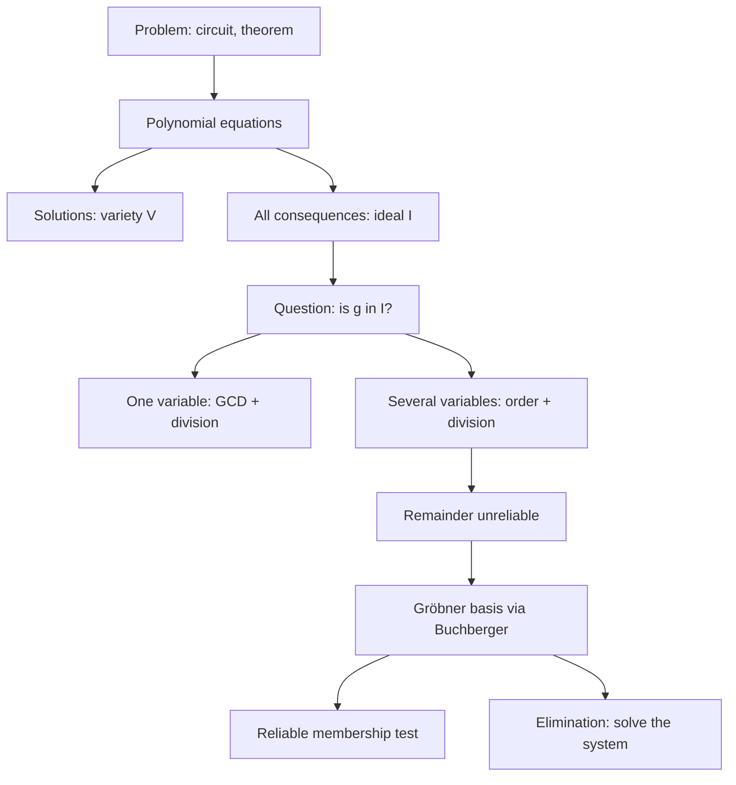

# FMSE Block II – Algebraic Reasoning from scratch — worksheet (lectures 1–3)

> [!info] How to use
> - This one worksheet covers **all three lectures** (slides 1–90). You do not need the slides to follow it.
> - Every section has the same layout: **In plain words → New words → Worked example → Tasks**. Each new word is explained once, in the section where it first appears.
> - The exact definitions from the slides are in a collapsed block **Slide version**. Read them last: they should feel like a summary of what you already understood.
> - Every task has a **Given** block, then a **Hint**, then the **Answer**. All are collapsed. Try first.
> - **Short on time? Do the ⭐ tasks.** They are enough to follow the whole story.

---

## 0. The whole story first

> [!abstract] The story in 7 steps
> 1. **Translate.** A circuit or a theorem becomes a set of polynomial equations: f₁ = 0, f₂ = 0, …
> 2. **Solutions.** The points that satisfy all equations are called the **variety**.
> 3. **Consequences.** If you multiply equations by anything and add them, you get new equations that are also true at every solution. All equations you can get this way form the **ideal**.
> 4. **The main question.** "Is my circuit correct?" becomes "does the equation g = 0 follow from the others in this way?" This is **ideal membership**: is g in the ideal?
> 5. **One variable: solved.** Replace all equations by one polynomial, their **GCD**. Divide g by it. Remainder 0 means yes, anything else means no.
> 6. **Several variables: problem.** Division still exists, but it needs an **order** of monomials, and its remainder is unreliable: it can be nonzero although g is in the ideal.
> 7. **The fix: Gröbner bases.** A **Gröbner basis** is a better set of equations for the same ideal. With it, the remainder is reliable (0 means yes, nonzero means no), and **Buchberger's algorithm** computes it. With a suitable order it also solves systems of equations, one variable at a time (**elimination**).

> [!tip] Analogy: rules of a board game
> - **Equations** = the rule book.
> - **Variety** = all game positions that obey every rule.
> - **Ideal** = every rule you can derive from the rule book, stated or not.
> - **Membership** = "does this new rule already follow from the book?"
> - **Gröbner basis** = the same rules, rewritten so that any question can be answered by simply looking things up.

### Slide map

| Slides | Topic | Section |
|---|---|---|
| 1–5 | Multiplier, Thales, roadmap | 1 |
| 6–13 | Binary operations, rings, fields | 2 |
| 14–19 | Monomials, polynomials, polynomial functions | 3 |
| 20–22 | Varieties | 4 |
| 23–30 | Consequences, ideals, bases | 5 |
| 31–43 | One variable: division, GCD, membership | 6 |
| 44–52 | Monomial orders | 7 |
| 53–58 | Division by several polynomials | 8 |
| 59–64 | Monomial ideals | 9 |
| 65–71 | Leading terms of an ideal, Gröbner bases | 10 |
| 72–78 | S-polynomials, Buchberger's algorithm | 11 |
| 79–84 | Using Gröbner bases, minimal and reduced ones | 12 |
| 85–90 | Elimination, solving systems | 13 |

### Notation

> [!abstract]- Symbols: lookup table (open whenever a symbol looks unfamiliar)
>
> | Symbol | Read as | Plain meaning | Section |
> |---|---|---|---|
> | ℕ₀, ℤ, ℚ, ℝ, ℂ | naturals with 0, integers, rationals, reals, complex | number sets | 2 |
> | ℤₙ | integers mod n | {0, …, n − 1}, compute and keep the remainder | 2 |
> | 𝔽₂ | field with two elements | same as ℤ₂ = {0, 1} | 3 |
> | K | a field | "your numbers": ℚ, ℝ, ℂ or ℤₚ | 2 |
> | K[x, y] | polynomials in x, y over K | all polynomials with coefficients in K | 3 |
> | xᵅ, α = (2, 0, 1) | x to the alpha | short for x²z: α lists the exponents | 3 |
> | \|α\| | total degree | sum of the exponents | 3 |
> | deg(f) | degree of f | largest total degree of a term of f | 3 |
> | Kⁿ | n-dimensional space | all lists of n numbers | 3 |
> | V(f₁, …, fₛ) | variety of f₁ … fₛ | all common solutions | 4 |
> | ∩, ∪, ⊆, ⊂ | intersection, union, subset, strict subset | set operations | 4 |
> | ⟨f₁, …, fₛ⟩ | ideal generated by f₁ … fₛ | all sums h₁f₁ + … + hₛfₛ | 5 |
> | ∈, ∉ | is in, is not in | membership | 5 |
> | Σ | sum | add up | 5 |
> | f \| g, f ∤ g | f divides g, f does not divide g | g = f · something | 3 |
> | LT(f), LM(f), LC(f) | leading term, monomial, coefficient | the "biggest" term, without and with its number | 6, 7 |
> | q, r | quotient, remainder | f = qg + r | 6 |
> | GCD(f, g) | greatest common divisor | the biggest polynomial dividing both | 6 |
> | >lex, >grlex, >grevlex | lex, graded lex, graded reverse lex | three ways to order monomials | 7 |
> | multideg(f) | multidegree | exponent vector of the leading monomial | 7 |
> | F = (f₁, …, fₛ) | ordered list of divisors | order matters | 8 |
> | rem_F(f) | remainder of f on division by F | what is left after dividing | 8 |
> | LT(I) | leading terms of I | leading terms of **all** elements of I | 10 |
> | ⟨LT(I)⟩ | ideal of leading terms | ideal generated by LT(I) | 10 |
> | G | Gröbner basis | a "good" set of generators | 10 |
> | LCM | least common multiple | smallest monomial divisible by both | 11 |
> | S(f, g) | S-polynomial | combination that cancels both leading terms | 11 |
> | S →_G 0 | S reduces to 0 modulo G | dividing S by G leaves 0 | 11 |
> | Iₗ | l-th elimination ideal | elements of I without x₁ … xₗ | 13 |
> | ⇒, ⇔ | implies, if and only if | reasoning, not part of a formula | all |
> | ⇝ | leads to | used on slides for "answer" | 6 |

> [!abstract]- Dictionary: English → Polish
>
> | English | Polish | English | Polish |
> |---|---|---|---|
> | ring | pierścień | variety | rozmaitość |
> | field | ciało | ideal | ideał |
> | unity | jedynka | generator | generator |
> | invertible | odwracalny | basis | baza |
> | polynomial | wielomian | principal ideal | ideał główny |
> | monomial | jednomian | leading term | wyraz wiodący |
> | term | wyraz | remainder | reszta |
> | coefficient | współczynnik | quotient | iloraz |
> | total degree | stopień całkowity | GCD | NWD |
> | divides | dzieli | monomial order | porządek jednomianowy |
> | consequence | konsekwencja | Gröbner basis | baza Gröbnera |
> | affine space | przestrzeń afiniczna | elimination | eliminacja |

> [!warning] No lecture notes
> There are no own notes with exam hints for this block, so the emphasis follows the slides. The slides keep returning to three questions (slides 30, 43, 90): can every ideal be written with finitely many generators, how to find a good basis, and how to decide membership. Division, Buchberger and membership are therefore probably the key skills. That is an interpretation, not a statement from the slides.

> [!warning] A word that changed meaning
> In lecture 4 of Block I a **term** was a logical object like f(x, c). In this block a **term** is a number times a monomial, like −5x²z.

---

## 1. Why polynomials at all? (slides 1–5)

> [!abstract] In plain words
> You want to know if a circuit is correct for **all** inputs. Testing them all is hopeless: a 64-bit multiplier has 2¹²⁸ input pairs. So describe the circuit by equations and prove the specification **from the equations**, the way you prove something in school algebra.

> [!note] New words
>
> | Word | Plain meaning | Example |
> |---|---|---|
> | gate polynomial | an equation that says what one gate does, for bits 0 and 1 | AND: h − fg = 0 |
> | specification | what the circuit should compute, as a polynomial that must be 0 | S = s − a · b |

> [!example] Worked example: gates as equations (slide 2)
> For bits f, g, h:
>
> | Gate | Equation | Why it works |
> |---|---|---|
> | h = f ∧ g | h − fg = 0 | fg is 1 only if both are 1 |
> | h = f ⊕ g | h − f − g + 2fg = 0 | f + g is right, except 1 + 1 = 2 must become 0: subtract 2fg |
>
> A geometry theorem works the same way (slide 3). Take the unit circle, opposite points A = (a, b), B = (−a, −b), and a point C = (x, y). The hypotheses "A and C lie on the circle" are h₁ = a² + b² − 1 = 0 and h₂ = x² + y² − 1 = 0. The claim "right angle at C" becomes g = (a − x)(−a − x) + (b − y)(−b − y) = 0. Since g = h₂ − h₁, the claim **follows** from the hypotheses.

![[FMSE-B2W1-slajd01.png|600]]

> [!quote]- Slide version: roadmap (slide 4)
>
> | § | Topic | Gives us |
> |---|---|---|
> | 1 | Basic structures | rings, fields, polynomials |
> | 2 | Ideals | all consequences of a set of equations |
> | 3 | Univariate polynomials | division, GCD, deciding ideal membership |
> | 4 | Multivariate polynomials | monomial orders, division by several polynomials |
> | 5 | Monomial ideals | finitely many generators suffice |
> | 6 | Gröbner bases | deciding ideal membership |
> | 7 | Elimination theory | eliminating variables, solving systems |
>
> Reading (slide 5): Cox, Little, O'Shea, *Ideals, Varieties, and Algorithms*.

### Tasks

- [x] **1.1 ⭐ (slide 2)** Check that f + g − 2fg equals f ⊕ g on all four inputs. ✅ 2026-11-02

> [!abstract] Given
> f, g ∈ {0, 1}. f ⊕ g = 1 iff exactly one of them is 1.

> [!tip]- Hint
> Fill a table with rows (0, 0), (0, 1), (1, 0), (1, 1).

> [!success]- Answer
>
> | f | g | f + g − 2fg | f ⊕ g |
> |---|---|---|---|
> | 0 | 0 | 0 | 0 |
> | 0 | 1 | 1 | 1 |
> | 1 | 0 | 1 | 1 |
> | 1 | 1 | 2 − 2 = 0 | 0 |

- [x] **1.2 (slide 1)** Compute the output of the 2-bit multiplier for a = 2, b = 3. Is s = a · b? ✅ 2026-11-02

> [!abstract] Given
> a = 2a₁ + a₀, b = 2b₁ + b₀, s = 8s₃ + 4s₂ + 2s₁ + s₀. Gates:
>
> | Signal | Gate |
> |---|---|
> | s₀ | a₀ ∧ b₀ |
> | p₀₁ | a₀ ∧ b₁ |
> | p₁₀ | a₁ ∧ b₀ |
> | p₁₁ | a₁ ∧ b₁ |
> | s₁ | p₀₁ ⊕ p₁₀ |
> | c | p₀₁ ∧ p₁₀ |
> | s₂ | c ⊕ p₁₁ |
> | s₃ | c ∧ p₁₁ |

> [!tip]- Hint
> First the bits: a = 2 is a₁ = 1, a₀ = 0; b = 3 is b₁ = 1, b₀ = 1.

> [!success]- Answer
>
> | s₀ | p₀₁ | p₁₀ | p₁₁ | s₁ | c | s₂ | s₃ |
> |---|---|---|---|---|---|---|---|
> | 0 | 0 | 1 | 1 | 1 | 0 | 1 | 0 |
>
> s = 4 + 2 = **6 = 2 · 3** ✓. One test proves nothing about the other 15 inputs; exam-style task E1 proves all of them at once.

- [x] **1.3 ⭐ (slide 3)** Expand g and show g = h₂ − h₁. ✅ 2026-11-02

> [!abstract] Given
> h₁ = a² + b² − 1, h₂ = x² + y² − 1, g = (a − x)(−a − x) + (b − y)(−b − y).

> [!tip]- Hint
> (a − x)(−a − x) has the form (−x + a)(−x − a), a difference of squares.

> [!success]- Answer
>
> | Step | Expression |
> |---|---|
> | 1 | (a − x)(−a − x) = x² − a² |
> | 2 | (b − y)(−b − y) = y² − b² |
> | 3 | g = x² + y² − a² − b² |
> | 4 | h₂ − h₁ = x² + y² − 1 − a² − b² + 1 = g ✓ |
>
> So h₁ = h₂ = 0 forces g = 0.

---

## 2. Where the numbers live: rings and fields (slides 6–13)

> [!abstract] In plain words
> Polynomials need numbers as coefficients. We only care which **operations** those numbers allow. A **ring** is any set where you can add, subtract and multiply sensibly, like the integers. A **field** also lets you **divide by anything except 0**, like the fractions. All of this block takes place over a field, written K, because division of polynomials needs to divide coefficients.

> [!note] New words
>
> | Word | Plain meaning | Example |
> |---|---|---|
> | binary operation | takes two elements of a set and gives one element of the same set | + on ℤ yes; − on ℕ no (2 − 5 ∉ ℕ) |
> | commutative | order of the two arguments does not matter | x + y = y + x |
> | associative | brackets do not matter | (x + y) + z = x + (y + z) |
> | ring | set with +, − and · that behave normally | ℤ, ℤ₆, 2×2 matrices |
> | commutative ring with unity | ring with xy = yx and with a number 1 | ℤ, ℤ₆, K[x] |
> | invertible | you can divide by it: uv = 1 for some v | 3 in ℤ₇ (3 · 5 = 1) |
> | field | commutative ring with 1 ≠ 0, every nonzero element invertible | ℚ, ℝ, ℂ, ℤ₅ |
> | ℤₙ | compute as usual, keep the remainder after dividing by n | in ℤ₆: 4 · 5 = 20 → 2 |

> [!important] The one fact to remember
> **ℤₙ is a field exactly when n is prime.** In ℤ₆, 2 · 3 = 0 although neither is 0, and 2 has no inverse.

> [!example] Worked example: finding an inverse
> What is 3⁻¹ in ℤ₇? Try: 3·1 = 3, 3·2 = 6, 3·3 = 2, 3·4 = 5, 3·5 = 15 → **1**. So 3⁻¹ = 5.

> [!quote]- Slide version
> - A **binary operation** on R is a function taking two elements of R to R. (Slide 6 writes R ◦ R → R; the usual notation is R × R → R.)
> - A **ring** is a set R with + and · such that: + is associative and commutative, there is a zero 0, every x has an additive inverse −x, · is associative, and · is distributive over + (slide 8).
> - A **commutative ring with unity** also has xy = yx and a 1 with 1x = x (slide 10).
> - If 1 ≠ 0, u is **invertible** if there is v with uv = vu = 1 (slide 10).
> - A **field** is a commutative ring with unity 1 ≠ 0 in which every nonzero element is invertible (slide 12).
> - Examples (slide 13): rings: n × n matrices, 2ℤ. Commutative rings with unity: ℤ, ℤ₆, ℤ₈, P(S). Fields: ℚ, ℝ, ℂ, ℤₚ.

### Tasks

- [x] **2.1 ⭐ (slide 9)** Compute in ℤ₆. ✅ 2026-11-02

> [!abstract] Given
> (a) 3 + 5 (b) 3 · 5 (c) −5 (d) 2 · 3 (e) 5 · 5

> [!tip]- Hint
> Compute normally, then take the remainder after dividing by 6. −5 is the number that gives 0 when added to 5.

> [!success]- Answer
>
> | (a) | (b) | (c) | (d) | (e) |
> |---|---|---|---|---|
> | 8 → **2** | 15 → **3** | **1** | 6 → **0** | 25 → **1** |

- [x] **2.2 ⭐ (slides 10–11)** List all invertible elements of ℤ₇ and of ℤ₉ with their inverses. ✅ 2026-11-02

> [!abstract] Given
> u is invertible if uv = 1 for some v.

> [!tip]- Hint
> ℤ₇ has a prime modulus, so expect all nonzero elements. In ℤ₉ check what 3 · v can ever be.

> [!success]- Answer
>
> | Ring | Pairs u ↔ u⁻¹ | Not invertible |
> |---|---|---|
> | ℤ₇ | 1↔1, 2↔4, 3↔5, 6↔6 | 0 |
> | ℤ₉ | 1↔1, 2↔5, 4↔7, 8↔8 | 0, 3, 6 |

- [x] **2.3 ⭐ (slides 12–13)** Classify: field, commutative ring with unity (but not a field), ring only, or not a ring. ✅ 2026-11-02

> [!abstract] Given
> (a) ℤ₇ (b) ℤ₉ (c) ℚ (d) ℤ (e) 3ℤ (f) ℕ (g) 2×2 real matrices (h) ℚ[x]

> [!tip]- Hint
> ℕ: does 1 have a negative? 3ℤ: is 1 inside? Matrices: is AB = BA? ℚ[x]: does x have an inverse?

> [!success]- Answer
>
> | Example | Class | Reason |
> |---|---|---|
> | ℤ₇, ℚ | field | |
> | ℤ₉ | comm. ring with unity | 3 not invertible |
> | ℤ | comm. ring with unity | 2 not invertible |
> | ℚ[x] | comm. ring with unity | x not invertible |
> | 3ℤ | ring only | no 1 |
> | 2×2 matrices | ring only | not commutative |
> | ℕ | not a ring | no −1 |

- [x] **2.4 (slide 12)** Solve, and count the solutions. ✅ 2026-11-02

> [!abstract] Given
> (a) 3x = 5 in ℤ₇ (b) 2x = 3 in ℤ₆ (c) 2x = 4 in ℤ₆

> [!tip]- Hint
> (a) Multiply both sides by 3⁻¹ = 5. (b), (c) Try all six values.

> [!success]- Answer
>
> | Equation | Solutions |
> |---|---|
> | (a) | x = 5 · 5 = 25 → **4**, one solution |
> | (b) | 2x is always even: **none** |
> | (c) | **x = 2 and x = 5**, two solutions |
>
> In a field, ax = b with a ≠ 0 has exactly one solution. That is why we want fields.

- [x] **2.5 (slides 6–7)** Answer yes/no. Give a counterexample for every no. ✅ 2026-11-02

> [!abstract] Given
> (a) Is − a binary operation on ℕ? (b) Is − commutative on ℤ? (c) Is − associative on ℤ? (d) Is ÷ a binary operation on ℚ \ {0}?

> [!tip]- Hint
> One concrete example is enough for a "no".

> [!success]- Answer
>
> | No. | Answer | Reason |
> |---|---|---|
> | (a) | no | 2 − 5 ∉ ℕ |
> | (b) | no | 2 − 3 ≠ 3 − 2 |
> | (c) | no | (2 − 3) − 4 = −5, 2 − (3 − 4) = 3 |
> | (d) | yes | the quotient of nonzero rationals is a nonzero rational |

---

## 3. Polynomials: the vocabulary (slides 14–19)

> [!abstract] In plain words
> A polynomial is a finite sum of pieces like −5x²z. Each piece has a **number** and a **product of variables**. The whole block is about working with such pieces, so this vocabulary needs to be automatic.

> [!note] New words
>
> | Word | Plain meaning | Example in −5x²z |
> |---|---|---|
> | monomial | product of variables only, no number | x²z |
> | coefficient | the number in front | −5 |
> | term | coefficient times monomial, coefficient ≠ 0 | −5x²z |
> | exponent vector α | the exponents as a list, one per variable | (2, 0, 1) for variables x, y, z |
> | total degree | sum of the exponents | 2 + 0 + 1 = 3 |
> | deg(f) | largest total degree among the terms of f | |
> | polynomial ring K[x, y] | the set of all polynomials with coefficients in K | commutative with unity, not a field: x has no inverse |
> | f divides g | g = f · h for some polynomial h | (x − y) divides x² − y² |
> | f vanishes at a | f(a) = 0 | x² + y² − 1 vanishes at (1, 0) |
> | Kⁿ (affine space) | all lists of n numbers from K | ℝ² is the plane |

> [!important] Why x^α?
> The slides write xᵅ to mean "some monomial". With α = (2, 0, 1) it means x²y⁰z¹ = x²z. A polynomial is then written Σ aα xᵅ, which only says "a sum of terms".

> [!example] Worked example: reading a polynomial (slide 16)
> f = 2x³y²z + (3/2)y³z³ − 3xyz + y² in ℚ[x, y, z].
>
> | Term | Coefficient | Exponent | Total degree |
> |---|---|---|---|
> | 2x³y²z | 2 | (3, 2, 1) | 6 |
> | (3/2)y³z³ | 3/2 | (0, 3, 3) | 6 |
> | −3xyz | −3 | (1, 1, 1) | 3 |
> | y² | 1 | (0, 2, 0) | 2 |
>
> deg(f) = 6, and **two terms** reach it. So "the highest term" is not yet well defined with several variables. Section 7 fixes this.

> [!warning] Zero polynomial vs zero function (slide 19)
> A polynomial can give 0 at every point without being the zero polynomial, but only over a **finite** field. Over 𝔽₂: x² − x gives 0 at 0 and at 1. Over ℚ, ℝ, ℂ this cannot happen: equal functions mean equal polynomials.

> [!quote]- Slide version
> - Monomial: xᵅ = x₁^α₁ ⋯ xₙ^αₙ, α ∈ ℕ₀ⁿ, total degree |α| = α₁ + ⋯ + αₙ. Term: c xᵅ with c ∈ K, c ≠ 0 (slide 14).
> - Polynomial: finite sum f = Σ aα xᵅ. deg(f) = max{|α| : aα ≠ 0}. K[x₁, …, xₙ] is the set of all of them (slide 15).
> - K[x₁, …, xₙ] is a commutative ring with unity, not a field. f divides g if g = fh (slide 17).
> - Kⁿ = {(a₁, …, aₙ) : aᵢ ∈ K}. f vanishes at a if f(a) = 0, and on T if f(a) = 0 for all a ∈ T (slide 18).
> - If K is infinite, f = 0 in K[x₁, …, xₙ] ⇔ f is the zero function (slide 19).

### Tasks

- [x] **3.1 ⭐ (slide 14)** Give monomial, coefficient, exponent vector, total degree. ✅ 2026-11-02

> [!abstract] Given
> Variables x, y, z. (a) −3xy²z⁴ (b) 4 (c) ½z³ (d) x³y

> [!tip]- Hint
> A constant has the monomial 1 and exponent (0, 0, 0).

> [!success]- Answer
>
> | Term | Monomial | Coefficient | α | Total degree |
> |---|---|---|---|---|
> | (a) | xy²z⁴ | −3 | (1, 2, 4) | 7 |
> | (b) | 1 | 4 | (0, 0, 0) | 0 |
> | (c) | z³ | ½ | (0, 0, 3) | 3 |
> | (d) | x³y | 1 | (3, 1, 0) | 4 |

- [x] **3.2 ⭐ (slides 15–16)** Read the polynomial: give deg(f) and say how many terms reach it. ✅ 2026-11-02

> [!abstract] Given
> f = 4x²y³ − x⁵ + 7xy − 2 + y⁵ in ℚ[x, y].

> [!tip]- Hint
> Add up the exponents term by term.

> [!success]- Answer
>
> | Term | 4x²y³ | −x⁵ | 7xy | −2 | y⁵ |
> |---|---|---|---|---|---|
> | Total degree | 5 | 5 | 2 | 0 | 5 |
>
> **deg(f) = 5, reached by three terms.**

- [x] **3.3 (slide 18)** Evaluate f = x²y − 3y + 1 at the points. Does g = x² + y² − 1 vanish at them? ✅ 2026-11-02

> [!abstract] Given
> Points: (a) (0, 0) (b) (1, −1) (c) (3/5, 4/5)

> [!tip]- Hint
> Substitute the numbers for x and y.

> [!success]- Answer
>
> | Point | f | g | g vanishes? |
> |---|---|---|---|
> | (a) | 1 | −1 | no |
> | (b) | −1 + 3 + 1 = 3 | 1 | no |
> | (c) | 36/125 − 12/5 + 1 = −139/125 | 0 | **yes** |

- [x] **3.4 (slide 17)** Show that f divides g by giving h. For (c), show that it does not. ✅ 2026-11-02

> [!abstract] Given
>
> | No. | f | g |
> |---|---|---|
> | (a) | x − 1 | x³ − 1 |
> | (b) | x + y | x³ + y³ |
> | (c) | x − 1 | x² + 1 |

> [!tip]- Hint
> For (c): if x² + 1 = (x − 1)h, what do both sides give at x = 1?

> [!success]- Answer
>
> | No. | Result |
> |---|---|
> | (a) | h = x² + x + 1 |
> | (b) | h = x² − xy + y² |
> | (c) | at x = 1 the left side is 2 and the right side is 0: **f does not divide g** |

- [x] **3.5 (slide 19)** Is x³ − x the zero function over ℤ₃? Is it the zero polynomial? What about over ℚ? ✅ 2026-11-02

> [!abstract] Given
> ℤ₃ = {0, 1, 2}, compute mod 3.

> [!tip]- Hint
> Try all three values. Over ℚ try x = 2.

> [!success]- Answer
> Over ℤ₃: values 0, 0, 8 − 2 = 6 → 0, so it is the **zero function**, but **not the zero polynomial** (it has nonzero coefficients). Over ℚ, x = 2 gives 6 ≠ 0, so it is not the zero function.

---

## 4. Solutions: varieties (slides 20–22)

> [!abstract] In plain words
> A **variety** is a fancy word for **the set of all solutions** of a system of polynomial equations. Each equation describes a shape: a parabola, a circle, a line. Several equations at once means the points lying on **all** the shapes, so more equations can only give fewer points.

> [!note] New words
>
> | Word | Plain meaning | Example |
> |---|---|---|
> | V(f₁, …, fₛ) | all points where f₁ = 0 and … and fₛ = 0 | V(x² − 1) = {−1, 1} |
> | affine variety | same thing: a set of this form | a circle in ℝ² |

> [!important] Two rules
> - **More equations, fewer points:** V(f₁, f₂) = V(f₁) ∩ V(f₂).
> - **The field matters:** V(x² + 1) is empty in ℝ, but {i, −i} in ℂ.

![[FMSE-B2W1-slajd21.png|600]]

> [!example] Worked example: running example, circle and line
> f₁ = x² + y² − 1 (circle), f₂ = x − y (diagonal line). Solve V(f₁, f₂) in ℝ².
>
> | Step | Result |
> |---|---|
> | f₂ = 0 | y = x |
> | put into f₁ = 0 | 2x² = 1, so x = ±1/√2 |
> | V(f₁, f₂) | {(1/√2, 1/√2), (−1/√2, −1/√2)} |
>
> This running example returns in sections 5, 10, 11, 12 and 13.

> [!quote]- Slide version
> For f₁, …, fₛ ∈ K[x₁, …, xₙ], V(f₁, …, fₛ) = {a ∈ Kⁿ : fᵢ(a) = 0 for all 1 ≤ i ≤ s} (slide 20). Also V(f₁, f₂) = V(f₁) ∩ V(f₂) (slide 21).

### Tasks

- [x] **4.1 ⭐ (slide 20)** Compute over the given field. ✅ 2026-11-02

> [!abstract] Given
> (a) V(x² − 3x + 2) ⊆ ℝ (b) V(x² + 1) ⊆ ℝ (c) V(x² + 1) ⊆ ℂ (d) V(x² − 2) ⊆ ℚ (e) V(x² − 2) ⊆ ℝ

> [!tip]- Hint
> Factor when you can. Is √2 rational?

> [!success]- Answer
>
> | No. | Variety |
> |---|---|
> | (a) | {1, 2} |
> | (b) | ∅ |
> | (c) | {i, −i} |
> | (d) | ∅ |
> | (e) | {√2, −√2} |

- [x] **4.2 ⭐ (slide 21)** Compute in ℝ². ✅ 2026-11-02

> [!abstract] Given
> (a) V(y − x², y − 1) (b) V(y − x², y + 1) (c) V(xy, x + y − 1)

> [!tip]- Hint
> Use one equation to substitute into the other. In (c), xy = 0 means x = 0 or y = 0.

> [!success]- Answer
>
> | No. | Reasoning | Variety |
> |---|---|---|
> | (a) | y = 1, x² = 1 | {(−1, 1), (1, 1)} |
> | (b) | y = −1, x² = −1 | ∅ |
> | (c) | x = 0 ⇒ y = 1; y = 0 ⇒ x = 1 | {(0, 1), (1, 0)} |

- [x] **4.3 (slide 22)** Describe the varieties in ℝ³. ✅ 2026-11-02

> [!abstract] Given
> f = x² + y² + z² − 1 (unit sphere). (a) V(f, z) (b) V(f, z − 1) (c) V(f, z − 2)

> [!tip]- Hint
> Substitute z into f.

> [!success]- Answer
>
> | No. | After substituting | Variety |
> |---|---|---|
> | (a) | x² + y² = 1 | a circle in the plane z = 0 |
> | (b) | x² + y² = 0 | the point (0, 0, 1) |
> | (c) | x² + y² = −3 | ∅ |

---

## 5. Consequences: ideals (slides 23–30)

> [!abstract] In plain words
> Suppose f₁ = 0 and f₂ = 0 hold at some point. Then h₁f₁ + h₂f₂ = 0 holds there too, **whatever polynomials h₁, h₂ you choose**, since you only add multiples of zero. So every such combination is a **consequence**. The set of all such combinations is the **ideal** ⟨f₁, f₂⟩. It collects everything you can derive by "multiply and add".

> [!note] New words
>
> | Word | Plain meaning | Example |
> |---|---|---|
> | consequence | a polynomial that is 0 at all solutions | 2y² − 1 for the circle and line |
> | combination | h₁f₁ + … + hₛfₛ with polynomials hᵢ as multipliers | (1)·f₁ + (−x − y)·f₂ |
> | ideal | set of polynomials that contains 0 and is closed under adding, and under multiplying by **any** polynomial | all multiples of x² |
> | ⟨f₁, …, fₛ⟩ | the ideal generated by the fᵢ: all their combinations | ⟨x, x − 1⟩ contains 1 |
> | generators, basis | the polynomials you list inside ⟨ ⟩ | x² − 4, y² − 1 |
> | ideal membership | the question: is g ∈ ⟨f₁, …, fₛ⟩? | |

> [!important] Key facts
> - Every element of ⟨f₁, …, fₛ⟩ is a consequence, because it vanishes at every solution.
> - **Same ideal ⇒ same variety.** So you may swap the generators for simpler ones. The opposite fails: V(x) = V(x²) = {0}, yet ⟨x⟩ ≠ ⟨x²⟩.
> - To show g ∈ ⟨f₁, …, fₛ⟩, **write down the multipliers** hᵢ and expand.
> - To show two ideals are equal, show that each generator of one is a combination of the generators of the other, **in both directions**.

> [!example] Worked example: running example
> f₁ = x² + y² − 1, f₂ = x − y. Multiply f₂ by (x + y) to cancel x²:
>
> | Step | Computation |
> |---|---|
> | 1 | (x + y) f₂ = x² − y² |
> | 2 | f₁ − (x + y) f₂ = **2y² − 1** |
>
> So 2y² − 1 ∈ ⟨f₁, f₂⟩, and every solution has y = ±1/√2: a consequence **without x**.

> [!example] Worked example: a better basis (slide 29)
> I = ⟨2x² + 3y² − 11, x² − y² − 3⟩ is an ellipse and a hyperbola. Hard to read off.
>
> | New from old | Old from new |
> |---|---|
> | x² − 4 = ⅕[(2x² + 3y² − 11) + 3(x² − y² − 3)] | 2x² + 3y² − 11 = 2(x² − 4) + 3(y² − 1) |
> | y² − 1 = ⅕[(2x² + 3y² − 11) − 2(x² − y² − 3)] | x² − y² − 3 = (x² − 4) − (y² − 1) |
>
> So I = ⟨x² − 4, y² − 1⟩ and the solutions are obvious: (±2, ±1).

![[FMSE-B2W1-slajd29.png|600]]

> [!important] The three key questions (slide 30)
> 1. **Ideal description:** can every ideal be written with finitely many generators?
> 2. **Better bases:** how do we find generators from which the solutions can be read off?
> 3. **Ideal membership:** is there an algorithm to decide g ∈ ⟨f₁, …, fₛ⟩?
>
> The rest of this worksheet answers them.

> [!quote]- Slide version
> - g is a **consequence** of f₁ = ⋯ = fₛ = 0 if g vanishes on V(f₁, …, fₛ). Every g = h₁f₁ + ⋯ + hₛfₛ is a consequence (slide 24).
> - I ⊆ K[x₁, …, xₙ] is an **ideal** if 0 ∈ I; f, g ∈ I ⇒ f + g ∈ I; f ∈ I and h ∈ K[x₁, …, xₙ] ⇒ hf ∈ I (slide 25).
> - ⟨f₁, …, fₛ⟩ = {Σ hᵢfᵢ : hᵢ ∈ K[x₁, …, xₙ]} (slide 27).
> - I is **finitely generated** if I = ⟨f₁, …, fₛ⟩; then f₁, …, fₛ is a **basis** of I (slide 28).
> - V(f₁, …, fₛ) = V(⟨f₁, …, fₛ⟩); if two bases generate the same ideal, their varieties are equal (slide 28).

### Tasks

- [x] **5.1 ⭐ (slide 24)** Find consequences with only x and with only y. Read off the solution. ✅ 2026-11-02

> [!abstract] Given
> f₁ = x + y − 3, f₂ = x − y − 1.

> [!tip]- Hint
> Add them. Subtract them.

> [!success]- Answer
> f₁ + f₂ = 2x − 4 gives x = 2. f₁ − f₂ = 2y − 2 gives y = 1. **V = {(2, 1)}.** School elimination is exactly this.

- [x] **5.2 ⭐ (slide 24)** Find a consequence that contains only x. ✅ 2026-11-02

> [!abstract] Given
> f₁ = xy − 1, f₂ = y − 2.

> [!tip]- Hint
> Multiply f₂ by x and subtract.

> [!success]- Answer
> f₁ − x f₂ = xy − 1 − xy + 2x = **2x − 1**, so x = ½ and V = {(½, 2)}.

- [x] **5.3 ⭐ (slide 26)** Ideal or not? For "not", name a violation. ✅ 2026-11-02

> [!abstract] Given
> Subsets of ℚ[x]: (a) {f : f(1) = 0} (b) {f : f(2) = 0 or f(3) = 0} (c) the constants (d) {f : deg(f) ≤ 3, or f = 0} (e) {f : f(0) = 1}

> [!tip]- Hint
> Check: contains 0? closed under +? closed under multiplying by x?

> [!success]- Answer
>
> | No. | Ideal? | Reason |
> |---|---|---|
> | (a) | yes | the multiples of x − 1 |
> | (b) | no | x − 2 and x − 3 are in, but their sum 2x − 5 is not |
> | (c) | no | 1 is in, but x · 1 = x is not |
> | (d) | no | x³ is in, but x · x³ = x⁴ is not |
> | (e) | no | 0 is not in the set |

- [x] **5.4 ⭐ (slide 27)** Show membership with explicit multipliers. ✅ 2026-11-02

> [!abstract] Given
> (a) x ∈ ⟨x², x − x²⟩ (b) 1 ∈ ⟨x + 1, x − 1⟩ (c) x² − y² ∈ ⟨x − y⟩ (d) x³ − 2x² ∈ ⟨x²⟩

> [!tip]- Hint
> Look for a combination that cancels what you do not want.

> [!success]- Answer
>
> | No. | Combination |
> |---|---|
> | (a) | x = 1 · x² + 1 · (x − x²) |
> | (b) | 1 = ½(x + 1) − ½(x − 1) |
> | (c) | x² − y² = (x + y)(x − y) |
> | (d) | x³ − 2x² = (x − 2) · x² |
>
> In (b), 1 is in the ideal, so **everything** is: multiply 1 by any polynomial.

- [x] **5.5 ⭐ (slide 29)** Find a better basis ⟨x² − c, y² − d⟩ and read off V(I) in ℝ². Show both directions. ✅ 2026-11-02

> [!abstract] Given
> I = ⟨f₁, f₂⟩, f₁ = x² + y² − 5, f₂ = x² − y² − 3.

> [!tip]- Hint
> Add and subtract, as for a linear system in x² and y².

> [!success]- Answer
>
> | Direction | Identities |
> |---|---|
> | new from old | x² − 4 = ½(f₁ + f₂), y² − 1 = ½(f₁ − f₂) |
> | old from new | f₁ = (x² − 4) + (y² − 1), f₂ = (x² − 4) − (y² − 1) |
>
> **I = ⟨x² − 4, y² − 1⟩, V(I) = {(±2, ±1)}.**

- [x] **5.6 (slide 27)** Show ⟨x + y, x − y⟩ = ⟨x, y⟩ in ℚ[x, y]. ✅ 2026-11-02

> [!abstract] Given
> Show that each generator on one side is a combination of the generators on the other side.

> [!tip]- Hint
> x = ½((x + y) + (x − y)).

> [!success]- Answer
>
> | Inclusion | Witness |
> |---|---|
> | left ⊆ right | x + y = 1·x + 1·y, x − y = 1·x − 1·y |
> | right ⊆ left | x = ½(x + y) + ½(x − y), y = ½(x + y) − ½(x − y) |

---

## 6. One variable: division, GCD, membership (slides 31–43)

> [!abstract] In plain words
> With one variable everything works, using school long division. Any number of equations can be replaced by **one** polynomial, their **GCD**. Then "is f in the ideal?" means "does the GCD divide f?", and a single division answers that.

> [!note] New words
>
> | Word | Plain meaning | Example |
> |---|---|---|
> | leading term LT(f) | the term with the highest power of x | LT(2x³ − 4x + 3) = 2x³ |
> | quotient q, remainder r | f = qg + r, with r = 0 or deg(r) < deg(g) | |
> | GCD | common divisor that all other common divisors divide | GCD(x⁴ − 1, x⁶ − 1) = x² − 1 |
> | principal ideal | ideal with a single generator | ⟨x − 1⟩ |
> | PID | ring where every ideal is principal | K[x], ℤ, but **not** K[x, y] |
> | Euclidean algorithm | repeatedly replace (f, g) by (g, remainder) until the remainder is 0 | |
> | extended Euclid | also records u, v with uf + vg = GCD | |

> [!important] Recipe: is f ∈ ⟨f₁, …, fₛ⟩ in one variable?
> 1. Compute h = GCD(f₁, …, fₛ) with the Euclidean algorithm. Then the ideal is ⟨h⟩.
> 2. Divide f by h.
> 3. f is in the ideal ⇔ remainder 0.

> [!warning] Do not divide by the original generators
> x − 1 is in ⟨x² − 1, x³ − 1⟩, since x − 1 = (x³ − 1) − x(x² − 1). But dividing x − 1 by x² − 1 or by x³ − 1 does nothing, because its degree is too small. **A nonzero remainder proves something only for the single generator** (slide 34).

> [!example] Worked example: division (slide 33)
> Divide f = x³ + 2x² + x + 1 by g = 2x + 1. Each step cancels the leading term of what is left.
>
> | Step | Next term of q | Subtract | What is left |
> |---|---|---|---|
> | 0 | | | x³ + 2x² + x + 1 |
> | 1 | x³ / 2x = ½x² | x³ + ½x² | (3/2)x² + x + 1 |
> | 2 | (3/2)x² / 2x = ¾x | (3/2)x² + ¾x | ¼x + 1 |
> | 3 | ¼x / 2x = ⅛ | ¼x + ⅛ | ⅞ |
>
> **q = ½x² + ¾x + ⅛, r = ⅞.** Quick check: if g = x − a, the remainder is f(a).

> [!example] Worked example: Euclid (slide 39)
>
> | Division | Remainder |
> |---|---|
> | x⁶ − 1 = x²(x⁴ − 1) + (x² − 1) | x² − 1 |
> | x⁴ − 1 = (x² + 1)(x² − 1) + 0 | 0 |
>
> The last nonzero remainder is the GCD: **x² − 1**. The GCD is unique only up to a constant factor, so x² − 1 and 2x² − 2 are both correct.

> [!tip] Extended Euclid as a table (slide 40)
> Start with rows (r, u, v) = (f, 1, 0) and (g, 0, 1). Each new row is **previous-but-one row − q · previous row**, in all three columns. Always rᵢ = uᵢf + vᵢg.

> [!quote]- Slide version
> - f = aₘxᵐ + ⋯ + a₀, aₘ ≠ 0: LT(f) = aₘxᵐ, deg(f) = m. For nonzero f, g: deg(f) ≤ deg(g) ⇔ LT(f) divides LT(g) (slide 31).
> - Division: for g ≠ 0 and every f there are unique q, r with f = qg + r, where r = 0 or deg(r) < deg(g) (slide 32).
> - Every ideal I ⊆ K[x] is I = ⟨f⟩, f unique up to a nonzero constant (slide 35).
> - If h ≠ 0: f ∈ ⟨h⟩ ⇔ h divides f ⇔ remainder 0 (slide 36).
> - h is a GCD of f, g if h divides both and every common divisor divides h. GCD(f, g) generates ⟨f, g⟩ (slide 37).
> - If f = qg + r then ⟨f, g⟩ = ⟨g, r⟩, hence GCD(f, g) = GCD(g, r) (slide 38).
> - GCD(f₁, …, fₛ) = GCD(f₁, GCD(f₂, …, fₛ)) for s ≥ 3 (slide 41).

### Tasks

- [x] **6.1 ⭐ (slide 33)** Divide f by g with a step table. ✅ 2026-11-02

> [!abstract] Given
> f = x⁴ − 3x² + 2, g = x − 1, in ℚ[x].

> [!tip]- Hint
> Remember that f has no x³ term. Check: the remainder must equal f(1).

> [!success]- Answer
>
> | Step | Next term of q | Subtract | What is left |
> |---|---|---|---|
> | 1 | x³ | x⁴ − x³ | x³ − 3x² + 2 |
> | 2 | x² | x³ − x² | −2x² + 2 |
> | 3 | −2x | −2x² + 2x | −2x + 2 |
> | 4 | −2 | −2x + 2 | 0 |
>
> **q = x³ + x² − 2x − 2, r = 0**, and f(1) = 0 ✓.

- [x] **6.2 (slide 32)** Divide f by g. ✅ 2026-11-02

> [!abstract] Given
> f = 2x³ − 3x² + 4x − 5, g = x² + 1, in ℚ[x].

> [!tip]- Hint
> Stop when the degree of what is left is below 2.

> [!success]- Answer
>
> | Step | Next term of q | Subtract | What is left |
> |---|---|---|---|
> | 1 | 2x | 2x³ + 2x | −3x² + 2x − 5 |
> | 2 | −3 | −3x² − 3 | 2x − 2 |
>
> **q = 2x − 3, r = 2x − 2.** Check: (2x − 3)(x² + 1) + 2x − 2 = 2x³ − 3x² + 4x − 5 ✓.

- [x] **6.3 (slides 12, 32)** Divide in ℤ₅[x]. All coefficients are computed mod 5. ✅ 2026-11-03

> [!abstract] Given
> f = x³ + 2x + 1, g = 2x + 3. In ℤ₅, 2⁻¹ = 3.

> [!tip]- Hint
> "Dividing by 2x" means multiplying by 3 and lowering the power of x by one.

> [!success]- Answer
>
> | Step | Next term of q | Subtract (mod 5) | What is left |
> |---|---|---|---|
> | 1 | 3x² | x³ + 4x² | x² + 2x + 1 |
> | 2 | 3x | x² + 4x | 3x + 1 |
> | 3 | 4 | 3x + 2 | 4 |
>
> **q = 3x² + 3x + 4, r = 4.**

- [x] **6.4 ⭐ (slide 39)** Compute GCD(x³ − 1, x² − 1) with Euclid. ✅ 2026-11-03

> [!abstract] Given
> f = x³ − 1, g = x² − 1.

> [!tip]- Hint
> Divide f by g, then g by the remainder.

> [!success]- Answer
>
> | Division | Remainder |
> |---|---|
> | x³ − 1 = x(x² − 1) + (x − 1) | x − 1 |
> | x² − 1 = (x + 1)(x − 1) + 0 | 0 |
>
> **GCD = x − 1.** The first line also gives x − 1 = (x³ − 1) − x(x² − 1): the combination from the warning above, found automatically.

- [x] **6.5 (slide 40)** Extended Euclid: find the GCD and u, v with uf + vg = GCD. ✅ 2026-11-03

> [!abstract] Given
> f = x³ − x, g = x² + x − 2.

> [!tip]- Hint
> The first quotient is x − 1. Divide the final row by 2 to normalize.

> [!success]- Answer
>
> | i | q | r | u | v |
> |---|---|---|---|---|
> | 0 | | x³ − x | 1 | 0 |
> | 1 | | x² + x − 2 | 0 | 1 |
> | 2 | x − 1 | 2x − 2 | 1 | −x + 1 |
> | 3 | ½x + 1 | 0 | | |
>
> **GCD = x − 1 = ½(x³ − x) − ½(x − 1)(x² + x − 2).**

- [x] **6.6 ⭐ (slides 35–36)** Decide membership in I = ⟨x² − 1, x³ − 1⟩. ✅ 2026-11-03

> [!abstract] Given
> I = ⟨x² − 1, x³ − 1⟩ = ⟨x − 1⟩ (task 6.4). (a) x⁵ − 1 (b) x² + 1

> [!tip]- Hint
> The remainder of division by x − 1 is f(1).

> [!success]- Answer
>
> | f | Remainder f(1) | Verdict |
> |---|---|---|
> | (a) | 0 | **in I** |
> | (b) | 2 | **not in I** |

- [ ] **6.7 (slides 41–42)** Find one generator of I and V(I) ⊆ ℝ. Is x³ + 1 ∈ I? Is x³ − 1 ∈ I?

> [!abstract] Given
> I = ⟨x⁴ − 1, x³ − x, x² + x⟩.

> [!tip]- Hint
> First GCD(x⁴ − 1, x³ − x), then the GCD of that with x² + x.

> [!success]- Answer
>
> | Step | Computation | Result |
> |---|---|---|
> | 1 | x⁴ − 1 = x(x³ − x) + (x² − 1), x³ − x = x(x² − 1) | x² − 1 |
> | 2 | x² − 1 = 1·(x² + x) + (−x − 1), x² + x = −x(−x − 1) | x + 1 |
>
> **I = ⟨x + 1⟩, V(I) = {−1}.** The remainder of division by x + 1 is f(−1): x³ + 1 gives 0 (**in**), x³ − 1 gives −2 (**not in**).

---

## 7. Several variables: ordering monomials (slides 44–52)

> [!abstract] In plain words
> Division always starts with the "biggest" term. With one variable that is obvious: x⁵ beats x². But in x²y + xy³, which is bigger? There is no natural answer, so we **choose a rule** for comparing monomials. Different rules give different leading terms, and all later computations depend on the choice. Therefore every Gröbner basis exercise states its order.

> [!note] New words
>
> | Word | Plain meaning | Example |
> |---|---|---|
> | monomial order | a fixed rule saying which of two monomials is bigger | lex, grlex, grevlex |
> | leading monomial LM(f) | the biggest monomial of f | |
> | leading coefficient LC(f) | its number | |
> | leading term LT(f) | LC(f) · LM(f) | |
> | multidegree | the exponent vector of LM(f) | |

> [!important] The three orders, as recipes
> Compare two monomials, with x > y > z. Write their exponents as lists.
>
> | Order | Rule | Example |
> |---|---|---|
> | **lex** | Compare the x exponents. If equal, compare y, then z. More wins. **Degree is ignored.** Like a dictionary. | x beats y⁵z³ |
> | **grlex** | Higher **total degree** wins. If tied, use lex. | z² beats x |
> | **grevlex** | Higher **total degree** wins. If tied, look at the **last** variable where they differ: **fewer wins**. | y² beats xz |
>
> Tie-break trick for grevlex: y² = (0, 2, 0), xz = (1, 0, 1). Start from the right: z exponents 0 and 1 differ, and y² has fewer z, so y² wins.

> [!example] Worked example: three orders, three leading terms (slide 51)
> f = 4xy²z + 4z² − 5x³ + 7x²z², x > y > z.
>
> | Order | Sorted, biggest first | LT(f) | Reason |
> |---|---|---|---|
> | lex | −5x³ + 7x²z² + 4xy²z + 4z² | −5x³ | most x, even with degree only 3 |
> | grlex | 7x²z² + 4xy²z − 5x³ + 4z² | 7x²z² | degree-4 tie: more x |
> | grevlex | 4xy²z + 7x²z² − 5x³ + 4z² | 4xy²z | degree-4 tie: fewer z |

> [!question] Why three orders?
> **lex** separates variables, which is what elimination needs (section 13). The slides do not compare computing costs. **Interpretation:** in practice graded orders are often faster, so tools commonly prefer them when elimination is not needed.

> [!quote]- Slide version
> A **monomial ordering** is a relation > on ℕ₀ⁿ such that: (1) it is total, (2) α > β ⇒ α + γ > β + γ for all γ, (3) it is a well-ordering, meaning every nonempty set has a smallest element (slide 46). In words: any two monomials can be compared; multiplying both by the same monomial keeps the order; and repeatedly decreasing must stop.
> - α >lex β if the leftmost nonzero entry of α − β is positive (slide 47).
> - α >grlex β if |α| > |β|, or |α| = |β| and α >lex β (slide 48).
> - α >grevlex β if |α| > |β|, or |α| = |β| and the rightmost nonzero entry of α − β is negative (slide 49).
> - multideg(f) = max{α : aα ≠ 0}, LC(f) = a_multideg(f), LM(f) = x^multideg(f), LT(f) = LC(f) · LM(f) (slide 52).

### Tasks

- [x] **7.1 ⭐ (slides 47–50)** Which monomial is bigger in each order? Use x > y > z. ✅ 2026-11-03

> [!abstract] Given
> (a) xy² and y³z (b) x²z and xy² (c) xz² and y³ (d) x³ and xyz²

> [!tip]- Hint
> Write the exponent vectors first. Compute the total degrees. For grevlex ties, look at the z exponents first.

> [!success]- Answer
>
> | Pair | lex | grlex | grevlex |
> |---|---|---|---|
> | (a) xy², y³z | xy² | y³z (degree 4 > 3) | y³z |
> | (b) x²z, xy² | x²z | x²z (tie, more x) | xy² (tie, fewer z) |
> | (c) xz², y³ | xz² | xz² (tie, more x) | y³ (tie, fewer z) |
> | (d) x³, xyz² | x³ | xyz² (degree 4 > 3) | xyz² |

- [x] **7.2 ⭐ (slides 51–52)** Sort f in all three orders. Give multideg(f), LC(f), LM(f), LT(f). ✅ 2026-11-03

> [!abstract] Given
> f = 2xyz − 3y³ + 5x²z³ − xy³z + z⁵ − 7x², x > y > z.
>
> | Term | 2xyz | −3y³ | 5x²z³ | −xy³z | z⁵ | −7x² |
> |---|---|---|---|---|---|---|
> | Exponent | (1,1,1) | (0,3,0) | (2,0,3) | (1,3,1) | (0,0,5) | (2,0,0) |
> | Degree | 3 | 3 | 5 | 5 | 5 | 2 |

> [!tip]- Hint
> Graded orders: the three degree-5 terms come first, then the two of degree 3, then −7x².

> [!success]- Answer
>
> | Order | Sorted | multideg | LC | LM | LT |
> |---|---|---|---|---|---|
> | lex | 5x²z³ − 7x² − xy³z + 2xyz − 3y³ + z⁵ | (2,0,3) | 5 | x²z³ | 5x²z³ |
> | grlex | 5x²z³ − xy³z + z⁵ + 2xyz − 3y³ − 7x² | (2,0,3) | 5 | x²z³ | 5x²z³ |
> | grevlex | −xy³z + 5x²z³ + z⁵ − 3y³ + 2xyz − 7x² | (1,3,1) | −1 | xy³z | −xy³z |

- [x] **7.3 (slide 47)** Give LT(f) in lex with x > y, then in lex with y > x. ✅ 2026-11-03

> [!abstract] Given
> f = x²y + xy³ − x⁵.

> [!tip]- Hint
> Changing the variable order changes which exponent you compare first.

> [!success]- Answer
>
> | Order | Comparison | LT(f) |
> |---|---|---|
> | x > y | highest x exponent | −x⁵ |
> | y > x | highest y exponent | xy³ |

- [x] **7.4 (slides 45–46)** Why is each rule **not** a monomial order? ✅ 2026-11-03

> [!abstract] Given
> (a) "Compare only the total degree." (b) "Smaller degree is bigger": 1 > x > x² > x³ > …

> [!tip]- Hint
> The three requirements: any two can be compared; multiplication keeps the order; decreasing must stop.

> [!success]- Answer
>
> | Rule | Fails | Why |
> |---|---|---|
> | (a) | total | x and y have equal degree but are different, so they cannot be compared |
> | (b) | well-ordering | 1 > x > x² > … decreases forever, so there is no smallest element |

- [x] **7.5 [extra]** Show on the monomials of degree 2 in x, y that grlex and grevlex agree when there are only two variables. ✅ 2026-11-03

> [!abstract] Given
> Monomials x², xy, y², with x > y.

> [!tip]- Hint
> With a fixed degree, fewer y means more x.

> [!success]- Answer
> Both give **x² > xy > y²**. With two variables and equal degree, "more x" (grlex) and "fewer y" (grevlex) are the same statement. The difference appears from three variables on (y² vs xz).

---

## 8. Division by several polynomials (slides 53–58)

> [!abstract] In plain words
> This is long division with several divisors. Look at the biggest term of what is left. If some divisor's leading term divides it, subtract a multiple of that divisor. If none does, **move that term to the remainder** and continue with the next one. The new part is this "move to the remainder" step: the process does not stop at the first undivisible term.

> [!important] The algorithm as a checklist
> Keep a working polynomial p, starting with p = f, and a remainder r = 0.
> 1. Take LT(p).
> 2. Go through the divisors **in the given order**. Does LT(fᵢ) divide LT(p)?
> 3. **Yes:** add LT(p)/LT(fᵢ) to aᵢ and subtract (LT(p)/LT(fᵢ))·fᵢ from p.
> 4. **No divisor works:** move LT(p) from p to r.
> 5. Repeat until p = 0.
>
> Result: f = a₁f₁ + … + aₛfₛ + r, and no term of r is divisible by any LT(fᵢ).

> [!example] Worked example (slide 54)
> Divide f = x²y + xy² + y² by F = (xy − 1, y² − 1), lex x > y. Leading terms: xy and y².
>
> | p | Step | a₁ | a₂ | r |
> |---|---|---|---|---|
> | x²y + xy² + y² | xy divides x²y: use f₁ with x | x | | |
> | xy² + x + y² | xy divides xy²: use f₁ with y | x + y | | |
> | x + y² + y | x not divisible: move to r | x + y | | x |
> | y² + y | y² divides y²: use f₂ with 1 | x + y | 1 | x |
> | y + 1 | y not divisible: move to r | x + y | 1 | x + y |
> | 1 | 1 not divisible: move to r | x + y | 1 | x + y + 1 |
>
> **f = (x + y)(xy − 1) + 1·(y² − 1) + (x + y + 1).**

> [!warning] Two problems (slides 57–58)
> 1. **The remainder depends on the order of the divisors.** With F = (y² − 1, xy − 1), the same f leaves 2x + 1 instead of x + y + 1.
> 2. **Remainder ≠ 0 does not prove f ∉ I.**
>
> | Remainder | What you may conclude |
> |---|---|
> | r = 0 | f ∈ I ✓ always |
> | r ≠ 0 | **nothing** in general |
>
> Gröbner bases exist to fix exactly this.

> [!quote]- Slide version
> Fix a monomial order and F = (f₁, …, fₛ). Every f can be written as f = a₁f₁ + ⋯ + aₛfₛ + r, where r = 0 or no monomial of r is divisible by any of LT(f₁), …, LT(fₛ). Moreover multideg(f) ≥ multideg(aᵢfᵢ) whenever aᵢfᵢ ≠ 0. Invariant: f = a₁f₁ + ⋯ + aₛfₛ + p + r. It terminates because multideg(p) strictly decreases and > is a well-ordering (slide 55).

### Tasks

- [x] **8.1 ⭐ (slide 54)** Divide f by F. Use lex with x > y. ✅ 2026-11-03

> [!abstract] Given
> f = xy² + 1, F = (xy + 1, y + 1).

> [!tip]- Hint
> Leading terms are xy and y. Always try f₁ first.

> [!success]- Answer
>
> | p | Step | a₁ | a₂ | r |
> |---|---|---|---|---|
> | xy² + 1 | use f₁ with y | y | | |
> | −y + 1 | xy no, y yes: use f₂ with −1 | y | −1 | |
> | 2 | not divisible: move to r | y | −1 | 2 |
>
> **xy² + 1 = y(xy + 1) − (y + 1) + 2.**

- [x] **8.2 (slide 53)** Divide f by the single polynomial g, lex x > y. ✅ 2026-11-03

> [!abstract] Given
> f = x² + y², g = x − y.

> [!tip]- Hint
> LT(g) = x. Stop only when p = 0.

> [!success]- Answer
>
> | p | Step | a | r |
> |---|---|---|---|
> | x² + y² | use g with x | x | |
> | xy + y² | use g with y | x + y | |
> | 2y² | x does not divide it: move to r | x + y | 2y² |
>
> **x² + y² = (x + y)(x − y) + 2y².**

- [x] **8.3 ⭐ (slide 54)** Divide f by F, lex x > y. ✅ 2026-11-03

> [!abstract] Given
> f = x²y + xy + y, F = (xy − 1, x + 1).

> [!tip]- Hint
> The second divisor has leading term x, so it divides anything containing x. The order still says: try f₁ first.

> [!success]- Answer
>
> | p | Step | a₁ | a₂ | r |
> |---|---|---|---|---|
> | x²y + xy + y | use f₁ with x | x | | |
> | xy + x + y | use f₁ with 1 | x + 1 | | |
> | x + y + 1 | xy no, x yes: use f₂ with 1 | x + 1 | 1 | |
> | y | not divisible: move to r | x + 1 | 1 | y |
>
> **r = y.** Check: (x + 1)(xy − 1) + (x + 1) + y = x²y + xy + y ✓.

- [ ] **8.4 ⭐ (slide 57)** Divide in both orders. Are the remainders equal?

> [!abstract] Given
> f = x²y + yz + z, lex x > y > z. (a) F = (xy − z, y − 1) (b) F = (y − 1, xy − z)

> [!tip]- Hint
> In (b), LT = y divides x²y, so f₁ is used first and the x² remains.

> [!success]- Answer
>
> | F | Steps | r |
> |---|---|---|
> | (a) | use f₁ with x, move xz to r, use f₂ with z, move 2z to r | **xz + 2z** |
> | (b) | use f₁ with x², move x² to r, use f₁ with z, move 2z to r | **x² + 2z** |
>
> **Different remainders.** So {xy − z, y − 1} cannot be a Gröbner basis (section 12).

- [ ] **8.5 ⭐ (slide 58)** Show that the remainder is nonzero although f is in the ideal.

> [!abstract] Given
> f = y, F = (x + y, x − y), lex x > y.

> [!tip]- Hint
> Division: x does not divide y. Membership: subtract the two generators.

> [!success]- Answer
> Both leading terms are x, and x does not divide y, so **r = y ≠ 0**. Yet y = ½(x + y) − ½(x − y) ∈ I. **Remainder ≠ 0 proved nothing.**

- [x] **8.6 (slide 55)** Which of these can be a final remainder when dividing by polynomials with leading terms xy and y²? ✅ 2026-11-03

> [!abstract] Given
> (a) x² + y (b) xy² + 1 (c) 3x − 2 (d) y³ (e) x⁵ + y

> [!tip]- Hint
> No term of r may be divisible by xy or by y².

> [!success]- Answer
>
> | No. | Allowed? | Reason |
> |---|---|---|
> | (a) | yes | |
> | (b) | no | xy² is divisible by xy |
> | (c) | yes | |
> | (d) | no | y³ is divisible by y² |
> | (e) | yes | |

---

## 9. Monomial ideals (slides 59–64)

> [!abstract] In plain words
> Some ideals are easy: those generated by plain monomials, like ⟨x³, x²y², y⁴⟩. For them, membership needs no algorithm: **a monomial is in the ideal exactly when some generator divides it.** You can even draw it, as a staircase of exponents. These easy ideals are the tool used to understand all others.

> [!note] New words
>
> | Word | Plain meaning | Example |
> |---|---|---|
> | monomial ideal | an ideal that can be generated by monomials | ⟨x⁴y², x³y⁴, x²y⁵⟩ |
> | staircase | the picture of exponents: each generator claims everything up and to the right of it | see below |
> | corner | a generator on the staircase; only these are needed | |
> | Dickson's Lemma | every monomial ideal needs only **finitely many** of its generators | ⟨xⁿ : n ≥ 3⟩ = ⟨x³⟩ |

> [!important] Two tests
> - **A monomial** is in I ⇔ some generator divides it.
> - **A polynomial** is in I ⇔ **every one** of its terms is in I.

![[FMSE-B2W2-slajd61.png|600]]

> [!example] Worked example (slide 61)
> I = ⟨x⁴y², x³y⁴, x²y⁵⟩.
>
> | Monomial | Divisible by a generator? | In I? |
> |---|---|---|
> | x⁵y³ | x⁴y² ✓ | yes |
> | x²y⁷ | x²y⁵ ✓ | yes |
> | x³y³ | none | no |
> | xy⁶ | none: needs at least x² | no |

> [!example] Worked example: only corners matter (slide 64)
> I = ⟨xⁱyʲ : i · j ≥ 4⟩ has infinitely many generators, but the corners xy⁴, x²y², x⁴y are enough: all others are divisible by one of them.

![[FMSE-B2W2-slajd64.png|600]]

> [!quote]- Slide version
> - I is a **monomial ideal** if I = ⟨xᵅ : α ∈ A⟩ for some A ⊆ ℕ₀ⁿ (slide 59).
> - xᵝ ∈ ⟨xᵅ : α ∈ A⟩ ⇔ xᵝ is divisible by some xᵅ. And xᵅ divides xᵝ ⇔ β = α + γ for some γ ∈ ℕ₀ⁿ (slide 60).
> - f ∈ I ⇔ every term of f lies in I. Two monomial ideals are equal ⇔ they contain the same monomials (slide 62).
> - **Dickson's Lemma:** every monomial ideal ⟨xᵅ : α ∈ A⟩ is generated by finitely many of its generators (slide 63).

### Tasks

- [x] **9.1 ⭐ (slide 61)** Decide membership in I = ⟨x³, x²y², y⁴⟩. ✅ 2026-11-13

> [!abstract] Given
> (a) x⁴y (b) x²y (c) xy⁴ (d) x²y³ (e) xy³

> [!tip]- Hint
> Try each generator: are both exponents at least as large?

> [!success]- Answer
>
> | Monomial | Divisor | In I? |
> |---|---|---|
> | (a) x⁴y | x³ | yes |
> | (b) x²y | none | no |
> | (c) xy⁴ | y⁴ | yes |
> | (d) x²y³ | x²y² | yes |
> | (e) xy³ | none | no |

- [x] **9.2 ⭐ (slide 62)** Polynomial in the same ideal? ✅ 2026-11-13

> [!abstract] Given
> I = ⟨x³, x²y², y⁴⟩. (a) 2x³y + 5y⁵ (b) x³ + xy (c) x²y² − 7x⁵

> [!tip]- Hint
> Check term by term.

> [!success]- Answer
>
> | f | Terms | In I? |
> |---|---|---|
> | (a) | x³y ✓, y⁵ ✓ | yes |
> | (b) | x³ ✓, xy ✗ | no |
> | (c) | x²y² ✓, x⁵ ✓ | yes |

- [x] **9.3 (slide 60)** List all monomials in x, y that are **not** in I = ⟨x³, x²y², y⁴⟩. ✅ 2026-11-13

> [!abstract] Given
> Draw the grid of exponents (a, b), mark the points of the generators (3, 0), (2, 2), (0, 4), and shade up and to the right.

> [!tip]- Hint
> Go column by column: a = 0, 1, 2. At a ≥ 3 everything is in I.

> [!success]- Answer
>
> | x exponent | Monomials not in I |
> |---|---|
> | 0 | 1, y, y², y³ |
> | 1 | x, xy, xy², xy³ |
> | 2 | x², x²y |
>
> **Exactly 10 monomials** lie under the staircase.

- [x] **9.4 (slide 59)** Is the ideal a monomial ideal? ✅ 2026-11-13

> [!abstract] Given
> (a) ⟨x², y³⟩ (b) ⟨x + y⟩ (c) ⟨x² + y², x²⟩

> [!tip]- Hint
> (c) Do not judge by the look of the generators: combine them. (b) If it were monomial, every term of x + y would be in it.

> [!success]- Answer
>
> | No. | Monomial? | Reason |
> |---|---|---|
> | (a) | yes | generated by monomials |
> | (b) | no | x ∉ ⟨x + y⟩, since multiples of x + y vanish at (1, −1) and x does not |
> | (c) | **yes** | (x² + y²) − x² = y², so it equals ⟨x², y²⟩ |

- [ ] **9.5 ⭐ (slides 63–64)** Find the finitely many corners.

> [!abstract] Given
> (a) ⟨xⁿy : n ≥ 2⟩ (b) ⟨xⁱyʲ : i + 2j ≥ 4⟩

> [!tip]- Hint
> For each y exponent j, find the smallest i that is allowed.

> [!success]- Answer
>
> | Ideal | Corners |
> |---|---|
> | (a) | ⟨x²y⟩ |
> | (b) | j = 0: i ≥ 4; j = 1: i ≥ 2; j = 2: i ≥ 0. So ⟨x⁴, x²y, y²⟩ |

---

## 10. The trouble and the fix: Gröbner bases (slides 65–71)

> [!abstract] In plain words
> Why was division unreliable? Because combinations of the generators can **cancel their leading terms** and leave something with a **new, smaller leading term** that no generator's leading term divides. Division cannot see it. A **Gröbner basis** is a set of generators for the same ideal that contains no such surprises: the leading term of **every** element of the ideal is divisible by the leading term of some generator.

> [!note] New words
>
> | Word | Plain meaning | Example |
> |---|---|---|
> | LT(I) | the leading terms of **all** polynomials in the ideal I | |
> | ⟨LT(I)⟩ | the monomial ideal they generate | |
> | hidden leading term | leading term of a combination, not divisible by the leading terms of the generators | x² on slide 66 |
> | Gröbner basis | generators G of I with ⟨LT(G)⟩ = ⟨LT(I)⟩: no hidden leading terms | {x + y, y² − 1} |

> [!example] Worked example: the smallest possible hidden term
> I = ⟨x + y, x − y⟩, lex x > y. Both leading terms are x. But (x + y) − (x − y) = **2y** is in I, and x does not divide 2y. So y is a hidden leading term, and {x + y, x − y} is **not** a Gröbner basis.

> [!example] Worked example (slides 66, 70)
> f₁ = x³ − 2xy, f₂ = x²y − 2y² + x, grlex. Multiply so the leading terms cancel:
>
> x · f₂ − y · f₁ = (x³y − 2xy² + x²) − (x³y − 2xy²) = **x²**
>
> x² is in I, but neither x³ nor x²y divides it: not a Gröbner basis.

> [!important] Two easy cases (slide 71)
> - **One generator:** {f} is always a Gröbner basis of ⟨f⟩.
> - **One variable:** {GCD(f₁, …, fₛ)} is a Gröbner basis. So **the Euclidean algorithm already computes Gröbner bases**, and section 6 was a special case all along.

> [!tip] How to prove each direction (slide 70)
> - **Not** a Gröbner basis: **one** element of I with a hidden leading term is enough.
> - **Is** a Gröbner basis: this needs an argument for every element of I. Buchberger's criterion (section 11) turns it into finitely many checks.

> [!quote]- Slide version
> - For an ideal I ≠ {0}: LT(I) = {cxᵅ : there is f ∈ I with LT(f) = cxᵅ}, and ⟨LT(I)⟩ is the ideal generated by it. For I = ⟨f₁, …, fₛ⟩ we have ⟨LT(f₁), …, LT(fₛ)⟩ ⊆ ⟨LT(I)⟩, and the inclusion can be strict (slide 65).
> - ⟨LT(I)⟩ is a monomial ideal, generated by LT(g₁), …, LT(gₜ) for some gᵢ ∈ I (slide 67).
> - **Hilbert Basis Theorem:** every ideal of K[x₁, …, xₙ] is finitely generated (slide 67). Proof idea: use Dickson to get finitely many gᵢ, then divide any f ∈ I by them; the remainder lies in I and must be 0 (slide 68).
> - A finite G = {g₁, …, gₜ} ⊆ I is a **Gröbner basis** if ⟨LT(g₁), …, LT(gₜ)⟩ = ⟨LT(I)⟩. Equivalently: the leading term of every f ∈ I is divisible by some LT(gᵢ) (slide 69).
> - Every ideal I ≠ {0} has a Gröbner basis, and every Gröbner basis of I generates I (slide 69).

### Tasks

- [x] **10.1 ⭐ (slide 66)** Check the computation x·f₂ − y·f₁ = x², and explain why it shows that {f₁, f₂} is not a Gröbner basis. ✅ 2026-11-13

> [!abstract] Given
> f₁ = x³ − 2xy, f₂ = x²y − 2y² + x, grlex, x > y.

> [!tip]- Hint
> Expand both products. Then compare x² with LT(f₁) and LT(f₂).

> [!success]- Answer
> x·f₂ = x³y − 2xy² + x², y·f₁ = x³y − 2xy², difference **x²**. LT(f₁) = x³ and LT(f₂) = x²y do not divide x². So x² is in I with a leading term not divisible by any generator's leading term: **not a Gröbner basis**.

- [x] **10.2 ⭐** Running example. Show that {x² + y² − 1, x − y} is not a Gröbner basis for lex x > y. ✅ 2026-11-13

> [!abstract] Given
> f₁ = x² + y² − 1, f₂ = x − y. From section 5: f₁ − (x + y) f₂ = 2y² − 1.

> [!tip]- Hint
> What are the leading terms of f₁ and f₂? Do they divide y²?

> [!success]- Answer
> LT(f₁) = x², LT(f₂) = x. The element 2y² − 1 ∈ I has leading term 2y², not divisible by x² or x. **Not a Gröbner basis.** A hidden leading term appeared.

- [x] **10.3 (slide 71)** One variable. Is {x² − 1, x³ − 1} a Gröbner basis of its ideal? What is one? ✅ 2026-11-13

> [!abstract] Given
> ⟨x² − 1, x³ − 1⟩ = ⟨x − 1⟩ (section 6).

> [!tip]- Hint
> x − 1 is in the ideal. Does x² or x³ divide its leading term?

> [!success]- Answer
> **No:** x − 1 ∈ I, but neither x² nor x³ divides x. **{x − 1}** is a Gröbner basis (one generator).

- [x] **10.4 (slide 70)** {x + z, y − z} is a Gröbner basis of J for lex x > y > z. Test this on the element y(x + z) − x(y − z). ✅ 2026-11-13

> [!abstract] Given
> Slide 70: every nonzero f ∈ J has x dividing LT(f) or y dividing LT(f).

> [!tip]- Hint
> Expand first; xy cancels.

> [!success]- Answer
> y(x + z) − x(y − z) = xy + yz − xy + xz = xz + yz. LT = **xz**, divisible by x = LT(x + z) ✓.

- [x] **10.5 (slide 65)** Why is ⟨LT(f₁), …, LT(fₛ)⟩ ⊆ ⟨LT(I)⟩ always true? What can go wrong in the other direction? ✅ 2026-11-13

> [!abstract] Given
> Each fᵢ is in I, so LT(fᵢ) ∈ LT(I).

> [!tip]- Hint
> Look at task 10.1.

> [!success]- Answer
> Each LT(fᵢ) is the leading term of an element of I, so it lies in LT(I), which gives ⊆. The other direction can fail, because combinations of the fᵢ can have new leading terms, like x² in task 10.1. **Gröbner basis means both sides are equal.**

---

## 11. S-polynomials and Buchberger's algorithm (slides 72–78)

> [!abstract] In plain words
> Hidden leading terms appear when leading terms cancel. So test exactly that: for each **pair** of generators, build the simplest combination that cancels their leading terms (the **S-polynomial**) and divide it by the generators. Remainder 0 for all pairs means there are no surprises, and you have a Gröbner basis. A nonzero remainder **is** a surprise: add it to the generators and test again. That is **Buchberger's algorithm**.

> [!note] New words
>
> | Word | Plain meaning | Example |
> |---|---|---|
> | LCM of monomials | take the bigger exponent of each variable | LCM(x³y², x⁴y) = x⁴y² |
> | S-polynomial S(f, g) | multiply f and g so that their leading terms become the same, then subtract | S(xy + 1, y² − 1) = x + y |
> | Buchberger's criterion | G is a Gröbner basis ⇔ every S(gᵢ, gⱼ) has remainder 0 on division by G | |
> | coprime leading monomials | they share no variable | x² and y³ |

> [!important] How to compute S(f, g)
> 1. Find LM(f), LM(g) and their LCM, called L.
> 2. Compute **S(f, g) = (L / LT(f)) · f − (L / LT(g)) · g**.
> 3. By construction, the L terms cancel.

> [!important] Buchberger's algorithm as a checklist
> 1. Start with G = your generators.
> 2. For each pair not yet checked, compute S and divide it by G.
> 3. Remainder 0: nothing to do.
> 4. Remainder h ≠ 0: add h to G. New pairs appear.
> 5. Stop when all pairs give remainder 0.
>
> **Shortcut:** a pair whose leading monomials are coprime can be skipped (slide 78).

> [!example] Worked example (slide 73)
> f = x³y² − x²y³ + x, g = 3x⁴y + y², grlex.
>
> | Step | Result |
> |---|---|
> | Leading monomials | x³y² and x⁴y |
> | LCM | x⁴y² |
> | Multipliers | x⁴y²/x³y² = x, x⁴y²/3x⁴y = ⅓y |
> | S(f, g) = x·f − ⅓y·g | (x⁴y² − x³y³ + x²) − (x⁴y² + ⅓y³) = **−x³y³ + x² − ⅓y³** |

> [!example] Worked example: a full run (slide 77)
> F = {f₁, f₂} = {x³ − 2xy, x²y − 2y² + x}, grlex, x > y.
>
> | Pair | S-polynomial | Remainder | Action |
> |---|---|---|---|
> | f₁, f₂ | −x² | −x² | add f₃ = −x² |
> | f₁, f₃ | −2xy | −2xy | add f₄ = −2xy |
> | f₁, f₄ | −2xy² = y·f₄ | 0 | – |
> | f₂, f₃ | −2y² + x | −2y² + x | add f₅ = −2y² + x |
> | all others | | 0 | – |
>
> **G = {f₁, f₂, f₃, f₄, f₅}.** The hidden x² from section 10 is now in the basis.

> [!quote]- Slide version
> - S(f, g) = (xᵞ/LT(f))·f − (xᵞ/LT(g))·g, with xᵞ = LCM(LM(f), LM(g)) (slide 72).
> - **Buchberger's Criterion:** a basis G of I is a Gröbner basis ⇔ for all i ≠ j the remainder of S(gᵢ, gⱼ) on division by G is 0 (slide 74).
> - Whether a set is a Gröbner basis depends on the order: {y − x², z − x³} is one for lex y > z > x, but not for lex x > y > z (slide 75).
> - The algorithm terminates because no new LT(h) is divisible by an earlier leading term, and by Dickson's Lemma this cannot go on forever (slide 76).
> - If LM(f), LM(g) are relatively prime, S(f, g) →_G 0 whenever f, g ∈ G (slide 78).

### Tasks

- [ ] **11.1 ⭐ (slide 73)** Compute the LCM of the monomials.

> [!abstract] Given
> (a) x²y and xy³ (b) x³ and y² (c) xy and y² (d) x²yz and yz³

> [!tip]- Hint
> Take the larger exponent of each variable.

> [!success]- Answer
>
> | (a) | (b) | (c) | (d) |
> |---|---|---|---|
> | x²y³ | x³y² | xy² | x²yz³ |

- [ ] **11.2 ⭐ (slide 73)** Compute S(f, g), lex x > y.

> [!abstract] Given
> f = xy + 1, g = y² − 1.

> [!tip]- Hint
> LCM(xy, y²) = xy². Multipliers: y for f, x for g.

> [!success]- Answer
> S = y(xy + 1) − x(y² − 1) = xy² + y − xy² + x = **x + y**.

- [ ] **11.3 (slide 73)** Compute S(f, g), grlex x > y.

> [!abstract] Given
> f = x²y + y², g = xy² + x.

> [!tip]- Hint
> LCM(x²y, xy²) = x²y².

> [!success]- Answer
> S = y·f − x·g = x²y² + y³ − x²y² − x² = **y³ − x²**.

- [ ] **11.4 ⭐ (slide 77)** Run Buchberger on {x + y, x − y}, lex x > y.

> [!abstract] Given
> g₁ = x + y, g₂ = x − y.

> [!tip]- Hint
> Start with S(g₁, g₂). For the later pairs the LCM is xy.

> [!success]- Answer
>
> | Pair | S | Remainder | Action |
> |---|---|---|---|
> | g₁, g₂ | (x + y) − (x − y) = 2y | 2y | add g₃ = 2y |
> | g₁, g₃ | y·g₁ − (x/2)·g₃ = y² | 0 (½y · g₃) | – |
> | g₂, g₃ | y·g₂ − (x/2)·g₃ = −y² | 0 | – |
>
> **G = {x + y, x − y, 2y}.**

- [ ] **11.5 ⭐ (slides 77–78)** Run Buchberger on {xy + 1, y² − 1}, lex x > y. Use the shortcut where possible.

> [!abstract] Given
> g₁ = xy + 1, g₂ = y² − 1. From task 11.2: S(g₁, g₂) = x + y.

> [!tip]- Hint
> Divide x + y by (g₁, g₂). Does anything divide x? Then consider the new pairs.

> [!success]- Answer
>
> | Pair | S | Remainder | Action |
> |---|---|---|---|
> | g₁, g₂ | x + y | x + y | add g₃ = x + y |
> | g₁, g₃ | g₁ − y·g₃ = 1 − y² | 0 (add g₂) | – |
> | g₂, g₃ | leading monomials y², x coprime | skip | – |
>
> **G = {xy + 1, y² − 1, x + y}.**

- [ ] **11.6 ⭐** Running example. Run Buchberger on {x² + y² − 1, x − y}, lex x > y.

> [!abstract] Given
> g₁ = x² + y² − 1, g₂ = x − y.

> [!tip]- Hint
> S = g₁ − x·g₂. Divide it: the term xy is still divisible by x.

> [!success]- Answer
>
> | Pair | S | Remainder | Action |
> |---|---|---|---|
> | g₁, g₂ | xy + y² − 1 | 2y² − 1 | add g₃ = 2y² − 1 |
> | g₁, g₃ | x², y² coprime | skip | – |
> | g₂, g₃ | x, y² coprime | skip | – |
>
> **G = {x² + y² − 1, x − y, 2y² − 1}.** The consequence from section 5 was found automatically.

- [ ] **11.7 (slide 78)** Is {x² + y, y³ + 1} a Gröbner basis for lex x > y? Answer without computing.

> [!abstract] Given
> Only one pair. Shortcut: coprime leading monomials need no check.

> [!tip]- Hint
> Look at x² and y³.

> [!success]- Answer
> **Yes.** x² and y³ share no variable, so the only pair can be skipped. All S-polynomials reduce to 0.

- [ ] **11.8 (slide 75)** Is {y − x², z − x³} a Gröbner basis in each order?

> [!abstract] Given
> (a) lex y > z > x (b) lex x > y > z

> [!tip]- Hint
> (a) What are the leading terms now? (b) They are −x² and −x³, with LCM x³.

> [!success]- Answer
>
> | Order | Leading terms | Result |
> |---|---|---|
> | (a) | y, z | coprime, so **yes** |
> | (b) | −x², −x³ | S = −x(y − x²) + (z − x³) = −xy + z. Neither x² nor x³ divides xy, so remainder ≠ 0: **no** |
>
> **Being a Gröbner basis depends on the order.**

---

## 12. Using Gröbner bases (slides 79–84)

> [!abstract] In plain words
> Now division is reliable. Dividing by a Gröbner basis gives the same remainder in **any order** of the divisors, and **f ∈ I ⇔ remainder 0**. Also, Buchberger's output is usually bloated. You can clean it into the **reduced Gröbner basis**, which is **unique** for a given order. That gives a fingerprint of an ideal: two ideals are equal exactly when their reduced bases are equal.

> [!note] New words
>
> | Word | Plain meaning | Example |
> |---|---|---|
> | normal form | the unique remainder of f on division by a Gröbner basis | |
> | minimal Gröbner basis | no leading term divides another, all leading coefficients 1 | |
> | reduced Gröbner basis | minimal, and no term of any element is divisible by the leading term of another element | {x + y, y² − 1} |

> [!important] Cleaning a Gröbner basis
> 1. **Remove** every g whose leading term is divisible by the leading term of another element.
> 2. **Normalize:** divide each g by its leading coefficient.
> 3. **Reduce:** replace each g by its remainder on division by the others.

> [!example] Worked example (slides 80, 82)
> From task 11.5: G = {xy + 1, y² − 1, x + y}, lex x > y.
> - Membership: divide f = xy² − x by G. Use x + y with y², then with −1, then y² − 1 with −y: remainder **0**, so f ∈ I. Without x + y in the basis, one division order left −x − y.
> - Cleaning: xy is divisible by x, so remove xy + 1. **Reduced basis: {x + y, y² − 1}.**
>
> For the run on slide 77: remove f₁ and f₂, normalize, and get **{x², xy, y² − ½x}** (slide 82).

> [!quote]- Slide version
> - Let G be a Gröbner basis of I. For each f there is a unique r such that no term of r is divisible by any LT(gᵢ) and f = g + r for some g ∈ I. So the remainder does not depend on how G is ordered; it is the **normal form**. The quotients can still depend on the order (slide 79).
> - **Ideal membership:** f ∈ I ⇔ the remainder of f on division by G is zero (slide 79).
> - If LT(p) ∈ ⟨LT(G \ {p})⟩, then G \ {p} is still a Gröbner basis (slide 82).
> - G is **minimal** if for all p ∈ G: LC(p) = 1 and LT(p) ∉ ⟨LT(G \ {p})⟩ (slide 82). G is **reduced** if for all p ∈ G: LC(p) = 1 and no monomial of p lies in ⟨LT(G \ {p})⟩ (slide 83).
> - For a fixed order, every ideal I ≠ {0} has a **unique** reduced Gröbner basis (slide 83).
> - ⟨f₁, …, fₛ⟩ = ⟨g₁, …, gₜ⟩ ⇔ both have the same reduced Gröbner basis, for a fixed order (slide 84).

### Tasks

- [ ] **12.1 ⭐ (slide 79)** Decide membership in I, by division with the reduced Gröbner basis.

> [!abstract] Given
> G = {x + y, y² − 1}, lex x > y. (a) x² − 1 (b) xy + 1 (c) x² + y (d) x − y

> [!tip]- Hint
> Use x + y first whenever x appears.

> [!success]- Answer
>
> | f | Steps | r | Verdict |
> |---|---|---|---|
> | (a) x² − 1 | x·g₁, −y·g₁, 1·g₂ | 0 | **in I** |
> | (b) xy + 1 | y·g₁, −1·g₂ | 0 | **in I** |
> | (c) x² + y | x·g₁, −y·g₁, 1·g₂, then move y and 1 | y + 1 | **not in I** |
> | (d) x − y | 1·g₁, then move −2y | −2y | **not in I** |

- [ ] **12.2 (slide 79)** Check on f = x² + y that the remainder does not depend on the order of the divisors.

> [!abstract] Given
> G = {x + y, y² − 1}, lex x > y. Divide by (x + y, y² − 1) and by (y² − 1, x + y).

> [!tip]- Hint
> LT(y² − 1) never divides x² or xy, so the steps barely change.

> [!success]- Answer
> Both orders give **r = y + 1**. Compare with task 8.4, where the divisors were not a Gröbner basis and the remainders differed.

- [ ] **12.3 ⭐ (slides 82–83)** Clean up the Gröbner bases from section 11 into reduced ones.

> [!abstract] Given
> (a) {x + y, x − y, 2y}, lex x > y (b) {x² + y² − 1, x − y, 2y² − 1}, lex x > y

> [!tip]- Hint
> (a) Two elements have LT = x: keep one. Then reduce it by y.

> [!success]- Answer
>
> | No. | Remove | Normalize | Reduce | Reduced basis |
> |---|---|---|---|---|
> | (a) | x − y | y from 2y | x + y → x | **{x, y}** |
> | (b) | x² + y² − 1 (x divides x²) | y² − ½ | nothing | **{x − y, y² − ½}** |
>
> (a) The ideal was ⟨x, y⟩ all along, which is task 5.6.

- [ ] **12.4 (slide 83)** Make the basis reduced.

> [!abstract] Given
> G = {x + y², y² − 1}, lex x > y. It is a Gröbner basis.

> [!tip]- Hint
> The term y² of the first element is divisible by LT of the second.

> [!success]- Answer
> (x + y²) − (y² − 1) = x + 1. **Reduced basis: {x + 1, y² − 1}.**

- [ ] **12.5 ⭐ (slide 84)** Compare the ideals using reduced Gröbner bases, lex x > y.

> [!abstract] Given
> I = ⟨xy + 1, y² − 1⟩, J = ⟨x + y, y² − 1⟩, K = ⟨x − y, y² − 1⟩. {x + y, y² − 1} and {x − y, y² − 1} are already reduced.

> [!tip]- Hint
> The reduced basis of I is in the worked example of this section.

> [!success]- Answer
>
> | Ideal | Reduced basis |
> |---|---|
> | I | {x + y, y² − 1} |
> | J | {x + y, y² − 1} |
> | K | {x − y, y² − 1} |
>
> **I = J, and K is different.**

- [ ] **12.6 (slide 81)** Use the Gröbner basis to decide. Do not divide fully in (b): look only at the leading term.

> [!abstract] Given
> I = ⟨xz − y², x³ − z²⟩, grlex, x > y > z. Gröbner basis G = {xz − y², x³ − z², x²y² − z³, xy⁴ − z⁴, y⁶ − z⁵}.
> (a) f = −4x²y²z² + y⁶ + 3z⁵ (b) f′ = xy − 5z² + x

> [!tip]- Hint
> (b) If f′ ∈ I, then LT(f′) would be divisible by some LT(gᵢ).

> [!success]- Answer
>
> | f | Reason | Verdict |
> |---|---|---|
> | (a) | f = (−4xy²z − 4y⁴)(xz − y²) − 3(y⁶ − z⁵) | **in I** |
> | (b) | LT(f′) = xy, not divisible by xz, x³, x²y², xy⁴, y⁶ | **not in I** |

---

## 13. Solving systems: elimination (slides 85–90)

> [!abstract] In plain words
> This is what you did at school with linear systems: get an equation with one variable, solve it, substitute back. Here is the good news: **a Gröbner basis in lex order does this automatically.** Its elements form a triangle: some use only the last variable, some the last two, and so on. So you solve from the bottom up.

> [!note] New words
>
> | Word | Plain meaning | Example |
> |---|---|---|
> | elimination | getting consequences that no longer contain some variables | 2y² − 1 has no x |
> | elimination ideal Iₗ | the part of the ideal that does not use x₁, …, xₗ | I₁ = polynomials of I without x |
> | extension | turn a partial solution into a full one, one variable at a time | from y to (x, y) |

> [!important] Recipe
> 1. Choose lex, with the variable you want to **keep** as the **smallest**.
> 2. Compute a Gröbner basis G.
> 3. Pick the element with the fewest variables and solve it.
> 4. Substitute back into the others.
>
> If G = {1}, then 1 ∈ I, so the system has **no solutions**.

> [!example] Worked example: running example, finished (slide 89)
> x² + y² = 1, x = y. Lex x > y gives G = {x − y, 2y² − 1}.
>
> | Step | Result |
> |---|---|
> | The element without x | 2y² − 1 = 0, so y = ±1/√2 |
> | Substitute into x − y = 0 | x = y |
> | Solutions | (1/√2, 1/√2), (−1/√2, −1/√2) |
>
> Same result as in section 4, but now produced by an algorithm.

![[FMSE-B2W3-slajd89.png|600]]

> [!example] Worked example (slides 85, 88)
> System x² + y + z = 1, x + y² + z = 1, x + y + z² = 1. Lex x > y > z gives:
>
> | Element | Variables | Part of |
> |---|---|---|
> | g₁ = x + y + z² − 1 | x, y, z | I₀ = I |
> | g₂ = y² − y − z² + z | y, z | I₁ |
> | g₃ = 2yz² + z⁴ − z² | y, z | I₁ |
> | g₄ = z⁶ − 4z⁴ + 4z³ − z² | z only | I₂ |
>
> g₄ = z²(z − 1)²(z² + 2z − 1), so z ∈ {0, 1, −1 ± √2}. Substituting back gives exactly five solutions: (1, 0, 0), (0, 1, 0), (0, 0, 1), and (t, t, t) with t = −1 ± √2.

> [!important] Key questions, answered (slide 90)
>
> | Question | Answer |
> |---|---|
> | Ideal description | every ideal is finitely generated (Hilbert Basis Theorem) |
> | Better bases | a Gröbner basis, computed by Buchberger; with lex, V(I) follows by elimination |
> | Ideal membership | divide f by G: f ∈ I ⇔ remainder 0 |
>
> For one variable, this is exactly section 6: the reduced Gröbner basis is {GCD(f₁, …, fₛ)}.

> [!quote]- Slide version
> - For I = ⟨f₁, …, fₛ⟩ ⊆ K[x₁, …, xₙ], the **l-th elimination ideal** is Iₗ = I ∩ K[xₗ₊₁, …, xₙ] (slide 87).
> - **Elimination Theorem:** if G is a Gröbner basis of I for lex with x₁ > ⋯ > xₙ, then Gₗ = G ∩ K[xₗ₊₁, …, xₙ] is a Gröbner basis of Iₗ, for every l (slide 87).
> - Every other polynomial in I ∩ K[z] is a multiple of g₄ (slide 88).

### Tasks

- [ ] **13.1 ⭐ (slides 87, 89)** Parabola and line. Solve the system with both variable orders.

> [!abstract] Given
> y − x² = 0, y − x − 2 = 0.
>
> | Order | Reduced Gröbner basis |
> |---|---|
> | lex x > y | {x − y + 2, y² − 5y + 4} |
> | lex y > x | {y − x − 2, x² − x − 2} |

> [!tip]- Hint
> Solve the element with one variable, then substitute into the other.

> [!success]- Answer
>
> | Order | One variable | Solutions |
> |---|---|---|
> | x > y | y² − 5y + 4 = (y − 1)(y − 4) | y = 1 → x = −1; y = 4 → x = 2 |
> | y > x | x² − x − 2 = (x − 2)(x + 1) | x = 2 → y = 4; x = −1 → y = 1 |
>
> **V = {(−1, 1), (2, 4)}** both ways. The elimination ideals differ, as slide 87 says.

- [ ] **13.2 ⭐ (slide 88)** Name the elimination ideals, and solve.

> [!abstract] Given
> x − y = 0, y − z = 0, x² + y² + z² − 3 = 0. Lex x > y > z gives G = {x − z, y − z, z² − 1}.

> [!tip]- Hint
> I₂ contains only polynomials in z.

> [!success]- Answer
>
> | Ideal | Generators |
> |---|---|
> | I₁ = I ∩ K[y, z] | y − z, z² − 1 |
> | I₂ = I ∩ K[z] | z² − 1 |
>
> z = ±1, then y = z, x = z. **V = {(1, 1, 1), (−1, −1, −1)}.**

- [ ] **13.3 (slide 85)** Use back-substitution to recover the first three solutions of the motivating example.

> [!abstract] Given
> g₁ = x + y + z² − 1, g₂ = y² − y − z² + z, g₃ = 2yz² + z⁴ − z², g₄ = z²(z − 1)²(z² + 2z − 1). Take z = 0 and z = 1.

> [!tip]- Hint
> For z = 0, g₃ gives no information: use g₂.

> [!success]- Answer
>
> | z | y | x from g₁ | Solutions |
> |---|---|---|---|
> | 0 | g₂: y² − y = 0, y = 0 or 1 | x = 1 − y | (1, 0, 0), (0, 1, 0) |
> | 1 | g₃: 2y = 0, y = 0 | x = 0 | (0, 0, 1) |

- [ ] **13.4 ⭐ (slide 90)** What does the Gröbner basis say about the system?

> [!abstract] Given
> x + y = 1, x + y = 2. Buchberger gives S = 1 at the first step, so the reduced Gröbner basis is {1}.

> [!tip]- Hint
> What can you derive from 1 = 0?

> [!success]- Answer
> 1 ∈ I, so 1 would be 0 at every solution, which is impossible. **V = ∅**, no solutions, in any field.

---

## Exam-style practice

- [ ] **E1 ⭐ [extra] (slides 1–2, 79)** Half adder. Show that the circuit is correct by division, then find the bug in the faulty version.

> [!abstract] Given
> Gates: s = a ⊕ b, c = a ∧ b. Polynomials g₁ = s − a − b + 2ab, g₂ = c − ab.
> Specification: S = 2c + s − a − b (sum of bits = output). Use lex s > c > a > b.
> Faulty version: the AND gate is replaced by a wire, c = a, so g₂′ = c − a.
> (a) Why is {g₁, g₂} a Gröbner basis? (b) Divide S by it. (c) Divide S by {g₁, g₂′} and find inputs where the faulty circuit is wrong.

> [!tip]- Hint
> (a) What are LT(g₁) and LT(g₂)? (c) Evaluate the remainder on bits.

> [!success]- Answer
> (a) Leading terms s and c are coprime, so the single pair can be skipped.
> (b)
>
> | p | Step |
> |---|---|
> | s + 2c − a − b | use g₁ with 1 |
> | 2c − 2ab | use g₂ with 2 |
> | 0 | done |
>
> **r = 0, so S ∈ ⟨g₁, g₂⟩: the half adder is correct.**
> (c) S − g₁ − 2g₂′ = **r = −2ab + 2a**. At a = 1, b = 0 it is 2: then s = 1, c = 1, and 2c + s = 3 ≠ 1 = a + b. The remainder points to a failing input.
> (Using outputs as the biggest variables is a choice made here; the slides do not state it. Interpretation: it makes gate polynomials into a Gröbner basis with coprime leading terms.)

- [ ] **E2 ⭐ [extra] (slides 72–83)** The whole pipeline, lex x > y.

> [!abstract] Given
> I = ⟨x² − y, xy − 1⟩.
> (a) Run Buchberger. (b) Give the reduced Gröbner basis. (c) Find V(I) ⊆ ℝ². (d) Is y² − x ∈ I? Is x² + y − 2 ∈ I?

> [!tip]- Hint
> S(g₁, g₂) = y·g₁ − x·g₂. New elements appear twice. Two of the later pairs are coprime.

> [!success]- Answer
> (a)
>
> | Pair | S | Remainder | Action |
> |---|---|---|---|
> | g₁, g₂ | x − y² | x − y² | add g₃ = x − y² |
> | g₁, g₃ | xy² − y | 0 (y·g₂) | – |
> | g₂, g₃ | y³ − 1 | y³ − 1 | add g₄ = y³ − 1 |
> | g₁, g₄ | x², y³ coprime | skip | – |
> | g₂, g₄ | x − y² | 0 (g₃) | – |
> | g₃, g₄ | x, y³ coprime | skip | – |
>
> (b) x² and xy are divisible by x: remove g₁, g₂. **Reduced: {x − y², y³ − 1}.**
> (c) y³ = 1 in ℝ gives y = 1, so x = 1. **V(I) = {(1, 1)}.**
> (d) y² − x = −(x − y²): **in I**. For x² + y − 2:
>
> | p | Step |
> |---|---|
> | x² + y − 2 | x·g₃ |
> | xy² + y − 2 | y²·g₃ |
> | y⁴ + y − 2 | y·g₄ |
> | 2y − 2 | move to r |
>
> **r = 2y − 2 ≠ 0: not in I**, although it vanishes at (1, 1). It fails at the complex solutions with y³ = 1, y ≠ 1. Vanishing on the real solutions is not enough.

- [ ] **E3 ⭐ [extra] (slides 87–89)** Circle and hyperbola. Solve.

> [!abstract] Given
> x² + y² = 5, xy = 2. Lex x > y gives the reduced Gröbner basis {x + ½y³ − (5/2)y, y⁴ − 5y² + 4}.

> [!tip]- Hint
> y⁴ − 5y² + 4 is quadratic in y².

> [!success]- Answer
> (y² − 1)(y² − 4) = 0, so y ∈ {±1, ±2}. Then x = −½y³ + (5/2)y:
>
> | y | 1 | −1 | 2 | −2 |
> |---|---|---|---|---|
> | x | 2 | −2 | 1 | −1 |
>
> **V = {(2, 1), (−2, −1), (1, 2), (−1, −2)}.** Check: xy = 2 and x² + y² = 5 ✓.

- [ ] **E4 [extra] (slides 66, 71, 79)** Same ideal, different orders. Give LT of each element, and say how the bases differ.

> [!abstract] Given
> I = ⟨x² − y, xy − 1⟩, x > y.
>
> | Order | Reduced Gröbner basis |
> |---|---|
> | lex | {x − y², y³ − 1} |
> | grlex | {x² − y, xy − 1, y² − x} |

> [!tip]- Hint
> In grlex, y² beats x because of the total degree.

> [!success]- Answer
>
> | Order | Leading terms |
> |---|---|
> | lex | x, y³ |
> | grlex | x², xy, y² |
>
> **The ideal is the same but the bases differ.** Lex gives the triangular shape needed for solving (y³ − 1 has only y). Uniqueness holds only **for a fixed order**.

- [ ] **E5 [extra] (slide 71)** One variable as a special case.

> [!abstract] Given
> I = ⟨x⁴ − 1, x⁶ − 1⟩. (a) Give a Gröbner basis. (b) Why is {x⁴ − 1, x⁶ − 1} not one? (c) Is x⁸ − 1 ∈ I? (d) Is x³ − 1 ∈ I?

> [!tip]- Hint
> (a) Use the GCD. (c), (d) Divide by it.

> [!success]- Answer
>
> | Part | Answer |
> |---|---|
> | (a) | **{x² − 1}**, since GCD = x² − 1 |
> | (b) | x² − 1 ∈ I, but neither x⁴ nor x⁶ divides x² |
> | (c) | x⁸ − 1 = (x⁶ + x⁴ + x² + 1)(x² − 1): **in I** |
> | (d) | x³ − 1 = x(x² − 1) + (x − 1): remainder ≠ 0, **not in I** |

---

## Cross-cutting tasks

- [ ] **P1** Explain in your own words why the division test works in one variable, fails with arbitrary generators in several variables, and works again with a Gröbner basis.
- [ ] **P2** What exactly does each object tell you: V(I), I, a Gröbner basis of I, the reduced Gröbner basis of I?
- [ ] **P3** Explain why Dickson's Lemma is needed twice: for the Hilbert Basis Theorem and for termination of Buchberger's algorithm.
- [ ] **P4** Why must K be a field for division to work?

> [!success]- Answer
> - **P1** In one variable the ideal has a single generator, and division by one polynomial has a unique remainder. With several generators in several variables, combinations can cancel leading terms and create hidden leading terms, which division cannot see. A Gröbner basis has no hidden leading terms: the leading term of every element of I is divisible by some LT(gᵢ), so a nonzero remainder really proves non-membership.
> - **P2** V(I): the solutions. I: everything that follows from the equations. A Gröbner basis: generators that make division reliable. The reduced Gröbner basis: a unique fingerprint of I for a fixed order.
> - **P3** Hilbert: ⟨LT(I)⟩ is a monomial ideal, and Dickson gives finitely many generators, which yields a finite basis. Buchberger: each new h has a leading term not divisible by earlier ones, so ⟨LT(G)⟩ strictly grows; Dickson says this cannot continue forever.
> - **P4** A division step computes LT(p)/LT(fᵢ), which divides leading coefficients. In ℤ[x], x²/(2x) = ½x does not exist. In a field every nonzero coefficient is invertible.

> [!warning] Common pitfalls
> - **Always note the monomial order.** The same polynomials give different leading terms and different bases.
> - **lex ignores degree:** x > y⁵z³.
> - **grevlex ties:** look at the last variable, and **fewer** wins.
> - In division, **do not stop** at the first undivisible term: move it to r and continue.
> - Try divisors **in the given order**, and start from the first divisor at each step.
> - **r = 0 proves membership. r ≠ 0 proves nothing**, unless you divide by a Gröbner basis.
> - **Same variety does not mean same ideal.** ⟨x⟩ and ⟨x²⟩ share V = {0}.
> - The multipliers hᵢ in an ideal are **polynomials**, not only numbers.
> - **Being a Gröbner basis depends on the order** (slide 75).
> - **S-polynomial:** divide by the leading **term**, including its coefficient.
> - The Gröbner basis result is unique only in its **reduced** form and for a **fixed order**.
> - **To eliminate x, make x biggest**, in lex.

> [!check] Can you…
> - [ ] write a gate as a polynomial and say why correctness means ideal membership?
> - [ ] tell ring from field, and compute inverses in ℤₙ?
> - [ ] name monomial, coefficient, term, exponent vector, total degree?
> - [ ] compute a simple variety?
> - [ ] check whether a set is an ideal, and show membership with explicit multipliers?
> - [ ] divide polynomials in one variable, and compute a GCD with Euclid?
> - [ ] compare monomials in lex, grlex and grevlex?
> - [ ] divide by several polynomials, using the remainder step?
> - [ ] explain why the remainder alone is unreliable?
> - [ ] decide membership in a monomial ideal, and find corners?
> - [ ] explain what a hidden leading term is?
> - [ ] compute an S-polynomial and run Buchberger on a small example?
> - [ ] turn a Gröbner basis into the reduced one?
> - [ ] use a Gröbner basis for membership and for equality of ideals?
> - [ ] solve a small system by reading a lex Gröbner basis from the bottom up?

> [!summary] One sentence for the exam
> A verification question becomes **ideal membership**: the equations generate an **ideal** of all their consequences, whose common solutions form the **variety**; in **one variable** the **GCD** generates the ideal, so one **division** decides membership, while in **several variables** one fixes a **monomial order**, sees that **multivariate division** alone is unreliable because of **hidden leading terms**, and repairs it with a **Gröbner basis** from **Buchberger's algorithm** (add remainders of **S-polynomials** until all reduce to 0), after which **f ∈ I ⇔ remainder 0**, the **reduced** basis is a unique fingerprint of the ideal, and a **lex** basis solves the system by **elimination**.
