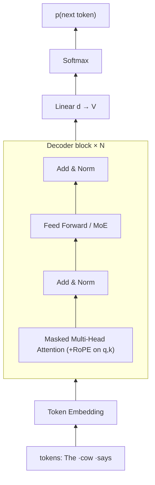

# 02 · Theoretical Foundations of Language Modelling (28 Oct)

> [!abstract] The lecture in one picture
> To predict the next token a model needs five things, and each has its own part of the transformer:
>
> | Need | Example | Part |
> |---|---|---|
> | What each piece means | ·cow is an animal; ·bank is money or river | **token embedding** |
> | How the pieces relate | "the cow says ___": cow shapes what says means | **(masked multi-head) attention** |
> | Where each piece stands | the cat sits on the table ≠ the table sits on the cat | **positional encoding** (RoPE) |
> | What the world knows | "the Eiffel Tower is in ___": no word says Paris | **feed-forward** (+ MoE) |
> | What comes next | a probability for every token | **linear + softmax** |
>
> Plus the glue: **Add & Norm** (residual stream + LayerNorm) and **N stacked decoder blocks**.

## Interactive page (5w1h)

<iframe src="https://5w1h.academy/introduction-to-generative-ai/module-01/language-modelling/#sec:attention" width="100%" height="750" style="border:1px solid #8884; border-radius:8px;"></iframe>

> [!tip] Section links
> [Neural networks](https://5w1h.academy/introduction-to-generative-ai/module-01/language-modelling/#sec:neural-networks) · [Embeddings](https://5w1h.academy/introduction-to-generative-ai/module-01/language-modelling/#sec:embeddings) · [Attention](https://5w1h.academy/introduction-to-generative-ai/module-01/language-modelling/#sec:attention) · [Queries & keys](https://5w1h.academy/introduction-to-generative-ai/module-01/language-modelling/#sec:queries-keys) · [Values](https://5w1h.academy/introduction-to-generative-ai/module-01/language-modelling/#sec:values) · [In matrices](https://5w1h.academy/introduction-to-generative-ai/module-01/language-modelling/#sec:attention-matrices) · [Scores & weights](https://5w1h.academy/introduction-to-generative-ai/module-01/language-modelling/#sec:attention-weights) · [Masked attention](https://5w1h.academy/introduction-to-generative-ai/module-01/language-modelling/#sec:masked-attention) · [Multi-head](https://5w1h.academy/introduction-to-generative-ai/module-01/language-modelling/#sec:multi-head) · [Position](https://5w1h.academy/introduction-to-generative-ai/module-01/language-modelling/#sec:position) · [RoPE](https://5w1h.academy/introduction-to-generative-ai/module-01/language-modelling/#sec:rope) · [Feed forward](https://5w1h.academy/introduction-to-generative-ai/module-01/language-modelling/#sec:feed-forward) · [Add & Norm](https://5w1h.academy/introduction-to-generative-ai/module-01/language-modelling/#sec:add-norm) · [Linear & softmax](https://5w1h.academy/introduction-to-generative-ai/module-01/language-modelling/#sec:head)
>
> This page has static figures only. For things to play with (softmax temperature/√dₖ, the causal mask, RoPE angles) open the **Attention**, **RoPE** and **LayerNorm** tabs of [[GenAI Lab|the interactive lab]].

---

## 0 · Neural network recap (shapes)

A network is a function $\hat y=f(x;\theta)$. ① initialise $\theta$ randomly → ② train with backpropagation (forward → loss → backward → each weight steps against its gradient) → ③ inference on new inputs.

Tensors by number of axes: scalar `()`, vector `(d)`, matrix `(n, d)`, tensor `(B, n, d)` = **B**atch × **n** tokens × **d** numbers per token. In the toy example "the cow says ___" with $n=3$ tokens of width 2: $X$ is (3,2), $W_1^\top$ is (2,2), $W_2^\top$ is (2,1), output $\hat Y$ is (3,1): **one prediction per position** ("is the next word moo?" at *every* word).

> [!example]+ Slide 10
> ![[GenAI-L2-slajd10.png|760]]

## 1 · Embedding

Token → token ID → **row** of the embedding table $E\in\mathbb{R}^{V\times d_{model}}$. Qwen3-0.6B: $V$ = 151,936 rows, $d_{model}$ = 1,024. It is a lookup; it does not look at neighbours; it is learned during training like every other weight.

> [!example]+ Slide 14
> ![[GenAI-L2-slajd14.png|760]]

## 2 · Attention: the core

**Goal:** compute *how much* (weights) and *how* (values) each token should shift the representation of every other token.

**Why not just the dot product of embeddings?** The dot product $a\cdot b=\lVert a\rVert\lVert b\rVert\cos\varphi$ measures *similarity*, but relevance ≠ similarity ("purple" is relevant to "cow" although they are not similar). So we first project into a learned **query–key space**.

### Step by step with shapes (one head, $n$ tokens)

| Step | Formula | Shape | Plain words |
|---|---|---|---|
| input | $X$ | $n\times d_{model}$ | one row per token (embedding, + position for some PE types) |
| queries | $Q=XW^Q$ | $n\times d_k$ | what each token is looking for |
| keys | $K=XW^K$ | $n\times d_k$ | what each token offers to be found by |
| values | $V=XW^V$ | $n\times d_v$ | *how* a token moves another one, kept separate from where it sits in meaning space |
| scores | $S=QK^\top$ | $n\times n$ | $s_{ij}=q_i\cdot k_j$ = how much word $j$ shapes the meaning of word $i$ |
| scale | $S/\sqrt{d_k}$ | $n\times n$ | same order, smaller range |
| mask (decoder) | $S/\sqrt{d_k}+M$ | $n\times n$ | $M_{ij}=-\infty$ for $j>i$ (future), 0 otherwise |
| weights | $\alpha=\text{softmax}_{\text{row}}(\cdot)$ | $n\times n$ | each row: numbers in [0,1] that sum to 1 |
| output | $\alpha V$ | $n\times d_v$ | $\text{out}_i=\sum_j\alpha_{ij}v_j$: weighted mix of values |

$$\text{Attention}(Q,K,V)=\text{softmax}\!\left(\frac{QK^\top}{\sqrt{d_k}}+M\right)V$$

> [!question] Which index is which? (the most common confusion)
> **Row $i$** = the token being updated (the *query*, "me"). **Column $j$** = the token being looked at (the *key/value*, "the one I attend to"). Softmax runs **along a row** (over $j$), so each token's weights over all others sum to 1. The mask kills columns $j>i$ in row $i$.

> [!example]+ Slides 18, 20
> ![[GenAI-L2-slajd18.png|760]]
>
> ![[GenAI-L2-slajd20.png|760]]

### Why divide by $\sqrt{d_k}$?

If the entries of $q$ and $k$ are roughly independent with variance 1, then $q\cdot k$ is a sum of $d_k$ terms, so its **variance grows like $d_k$** and its standard deviation like $\sqrt{d_k}$. Dividing by $\sqrt{d_k}$ keeps scores in a range where softmax is not saturated. With $d_k=64$: divide by 8 (slide: scores ÷ 8 → −5.6 … 5.6).

Without scaling: big scores → softmax gives one token ≈ all the weight and the rest ≈ 0 → gradients through softmax ≈ 0 → learning stalls. Scaling **keeps the order** of the scores (it's a positive constant), and it is *not* what makes the row sum to 1 (softmax does that). It has nothing to do with sequence length $n$.

> [!example]+ Slide 22
> ![[GenAI-L2-slajd22.png|760]]

<iframe src="https://jerzyszyjut.github.io/notes/university/notes/genai/genai-lab.htm#attention" width="100%" height="860" loading="lazy" style="border:1px solid #8884; border-radius:8px;"></iframe>

*Interactive: **Attention** tab of the [[GenAI Lab]] · [[genai-lab.htm|open it full screen]]*

### Softmax

$$\text{softmax}(s)_j=\frac{e^{s_j}}{\sum_i e^{s_i}}$$

- outputs in (0,1), sum to 1, keeps the order; adding the same constant to all $s_j$ changes nothing.
- $e^{-\infty}=0$, which is why the mask uses $-\infty$ **before** softmax: masked positions get exactly 0 and the remaining weights still sum to 1. Setting weights to 0 *after* softmax would leave rows summing to < 1.

> [!example]+ Slide 23
> ![[GenAI-L2-slajd23.png|760]]

### Masked (causal) attention

When learning $p(x_t\mid x_1,\dots,x_{t-1})$, each prediction may only use tokens **up to and including itself**. The mask makes position $t$ see exactly what it would see during generation, so **training computes all positions in parallel** in one pass (no loop over tokens), and the sum of all per-position losses = the chain-rule log-likelihood.

> [!example]+ Slide 27
> ![[GenAI-L2-slajd27.png|760]]

### Multi-head attention

Cut $Q,K,V$ into $h$ heads of width $d_{model}/h$; each head runs attention on its slice (its own "perspective", e.g. one head for syntax, one for coreference); **concatenate** the $h$ outputs (back to $d_{model}$) and mix with $W^O$. Original transformer: $d_{model}=512$, $h=8$, $d_k=d_v=64$. Cost ≈ one big head of the same total width.

```python
d_model, d_k = 512, 64
W_Q = nn.Linear(d_model, d_k, bias=False)   # same for W_K, W_V
Q, K, V = W_Q(x), W_K(x), W_V(x)            # [n, d_k] each
scores = Q @ K.T / math.sqrt(d_k)           # [n, n]
weights = scores.softmax(dim=-1)            # each row sums to 1
out = weights @ V                           # [n, d_k]
```

> [!summary] The 7 steps (slide)
> 1 make $Q,K,V$ · 2 score each query against each key · 3 divide by $\sqrt{d_k}$ · 4 in the decoder hide the future ($-\infty$ above the diagonal) · 5 softmax rows → weights summing to 1 · 6 weighted sum of values · 7 do it in $h$ heads, concatenate, project with $W^O$.

> [!example]+ Slide 28
> ![[GenAI-L2-slajd28.png|760]]

## 3 · Position: attention alone has no order

Attention is built from **pairs** ($q_i\cdot k_j$); the indices $i,j$ only pair words up. So without positional information and without a mask: shuffle the input → the outputs come out shuffled the same way:

$$\text{Attention}(PX)=P\cdot\text{Attention}(X)\qquad P=\text{permutation matrix}$$

"dog bites man" and "man bites dog": **dog gets the same output vector in both**, in every layer. Stacking layers doesn't help; adding the *same* vector to every token doesn't help; token IDs say *which* token, not *where*.

> [!note] Subtle point not stressed on the slides
> With a **causal mask**, attention is no longer permutation-equivariant: token 1 can only see itself, token 5 sees five tokens, so the model *can* infer some order (and "NoPE" models without positional encodings exist). The exam question specified "without a mask" for this reason.

> [!example]+ Slide 32
> ![[GenAI-L2-slajd32.png|760]]

### Absolute vs relative

| Method | How | + | − |
|---|---|---|---|
| **Learned absolute** (GPT-2) | table $P$ with one learned row per position (1,024 rows × 768), **added** to $X$ | model learns what positions should be | fixed max length (no row 1,024); late rows trained rarely |
| **Sinusoidal absolute** (original) | $PE(pos,2i)=\sin(pos/10000^{2i/d})$, $PE(pos,2i+1)=\cos(\cdot)$, **added** to $X$ | nothing to learn, any position; "$k$ positions later" = same fixed rotation of the vector | relative position only **implicit** |
| **Relative bias** (T5, ALiBi) | add a number $b_{j-i}$ per **distance** to the **scores**: $S+B$ | directly relative | – |
| **RoPE** (Llama, Qwen) | **rotate** $q$ and $k$ by an angle proportional to the position | relative by construction; no extra parameters | needs care to extend context (→ YaRN, TP II) |

**Sinusoidal variables:** $pos$ = position (0,1,2,…), $i$ = index of the sin/cos **pair** of dimensions, $d$ = model width. Each pair is a wave over positions; low $i$ = fast wave, high $i$ = slow wave ("slower and slower to the right").

> [!example]+ Slides 35, 36
> ![[GenAI-L2-slajd35.png|760]]
>
> ![[GenAI-L2-slajd36.png|760]]

### RoPE in detail

$$R(m)=\text{diag}\big(R(m\theta_1),R(m\theta_2),\dots,R(m\theta_{d/2})\big),\qquad \theta_i=b^{-2(i-1)/d}$$

| Variable | Meaning |
|---|---|
| $m$ | position of the token (query at $m$, key at $n$ – here $n$ is a *position*) |
| $i$ | which **pair** of dimensions (1 … $d/2$); dims 1–2 are pair 1 |
| $\theta_i$ | angle turned **per position** by pair $i$; pair 1: $\theta_1=b^0=1$ rad, later pairs exponentially slower |
| $b$ | base: 10,000 (orig., Llama 2) · 500,000 (Llama 3, Olmo 3) · 1,000,000 (Qwen3) |
| $d$ | dimension of the vectors being rotated (the **head** dimension) |
| $R(\phi)$ | 2×2 rotation $\begin{pmatrix}\cos\phi&-\sin\phi\\ \sin\phi&\cos\phi\end{pmatrix}$ |

Key identity: $(R(m)q)^\top(R(n)k)=q^\top R(n-m)\,k$. The score only depends on the **distance** $n-m$: ·says at 3 vs ·cow at 2 gives the same angle difference as positions 13 and 12.

- Only **$q$ and $k$** are rotated, **not $v$** (position should affect *how much* to attend, not *what* is carried).
- Applied **inside every attention layer**, not added once at the input.
- **Different speeds per pair**: fast pairs resolve nearby order (a full turn every few tokens), slow pairs distinguish far-apart positions without wrapping around. One speed alone fails: large steps wrap around (position 7 = position 1 after 360°), tiny steps make neighbours indistinguishable.

> [!example]+ Slides 38, 39, 40
> ![[GenAI-L2-slajd38.png|760]]
>
> ![[GenAI-L2-slajd39.png|760]]
>
> ![[GenAI-L2-slajd40.png|760]]

<iframe src="https://jerzyszyjut.github.io/notes/university/notes/genai/genai-lab.htm#rope" width="100%" height="860" loading="lazy" style="border:1px solid #8884; border-radius:8px;"></iframe>

*Interactive: **RoPE & YaRN** tab of the [[GenAI Lab]] · [[genai-lab.htm|open it full screen]]*

## 4 · Feed-forward: knowledge

"The Eiffel Tower is in ___": attention can only combine what is **in** the sentence; "Paris" is in no piece. The FFN applies **the same 2-layer network to each token on its own**:

$$\text{FFN}(x)=\text{ReLU}(xW_1)W_2,\qquad W_1: d_{model}\to d_{ff},\ W_2: d_{ff}\to d_{model},\ d_{ff}=4\,d_{model}$$

512 → 2,048 → 512 in the original. It holds **most of a block's weights** (2·512·2,048 ≈ 2.1M vs 4·512² ≈ 1.05M for attention) and is seen as the main store of world knowledge. Modern models use the gated **SwiGLU** variant.

**Mixture of experts (MoE):** replace the one FFN by many small expert FFNs + a **router** that picks $k$ experts **per token**; only those run, and their outputs are mixed by the router probabilities: $y=p_2E_2(x)+p_5E_5(x)$. More parameters (knowledge), same compute per token.

> [!example]+ Slides 44, 47
> ![[GenAI-L2-slajd44.png|760]]
>
> ![[GenAI-L2-slajd47.png|760]]

## 5 · Add & Norm: keeping it trainable

**Residual connection:** $x+\text{Attention}(x)$, $x+\text{FFN}(x)$: each sublayer *adds* what it found to the token's vector, which is carried straight up: the **residual stream**. Gradients flow through the identity path; deep stacks stay trainable.

**LayerNorm**, per token vector (over its $d$ numbers, *not* across the batch or across tokens):

$$\text{LayerNorm}(x)=\gamma\odot\frac{x-\mu}{\sqrt{\sigma^2+\epsilon}}+\beta,\quad \mu=\tfrac1d\sum_k x_k,\quad \sigma^2=\tfrac1d\sum_k(x_k-\mu)^2$$

$\epsilon\approx10^{-6}$ (never divide by 0), $\gamma,\beta$ learned per dimension (start 1 and 0). Purpose: every token's numbers back in the same range after every sublayer, however deep → stable training. Qwen3 uses **RMSNorm** (no mean subtraction, no $\beta$) and QK-norm. Original paper: post-norm $\text{Norm}(x+\text{Sub}(x))$; modern models (TP I recap): **pre-norm** $x+\text{Sub}(\text{Norm}(x))$.

> [!example]+ Slides 53, 54
> ![[GenAI-L2-slajd53.png|760]]
>
> ![[GenAI-L2-slajd54.png|760]]

<iframe src="https://jerzyszyjut.github.io/notes/university/notes/genai/genai-lab.htm#layernorm" width="100%" height="860" loading="lazy" style="border:1px solid #8884; border-radius:8px;"></iframe>

*Interactive: **LayerNorm** tab of the [[GenAI Lab]] · [[genai-lab.htm|open it full screen]]*

## 6 · Linear + softmax: what comes next

After the last block: a vector of $d$ (1,024) numbers per token, but we need **one number per vocabulary entry** (151,936), and they must be **probabilities**.

1. **Linear** $W_{out}\in\mathbb{R}^{d\times V}$ → logits (any real number, negative too). In Qwen3-0.6B it **shares** the embedding table (weight tying).
2. **Softmax** row by row → a distribution over the next token at **every** position.

Training scores **every** position (row $t$ predicts token $t+1$); generation uses **only the last row**.

> [!example]+ Slide 50
> ![[GenAI-L2-slajd50.png|760]]

## The full decoder-only model



> [!example]+ Slide 56
> ![[GenAI-L2-slajd56.png|760]]

---

## Exam traps from this lecture

- Only **attention** mixes information across tokens. Embedding, FFN, LayerNorm, final linear are all **per token**.
- $\sqrt{d_k}$: because scores grow with $d_k$ (vector length), **not** with $n$; prevents saturation/vanishing gradients; keeps the order; softmax (not the scaling) makes rows sum to 1.
- Mask with $-\infty$ **before** softmax → exactly 0 weight, rows still sum to 1; enables **parallel** training.
- No PE + no mask → permutation equivariant; same output vector for "dog" in both orders.
- RoPE rotates $q,k$ only, depends on relative distance, different frequency per pair, base $b$.
- FFN ≈ knowledge, holds most parameters; MoE router picks experts **per token**.
- LayerNorm normalises **within one token's vector**.
- Generation uses only the last row of logits; training uses all rows.

Related: [[GenAI - Glossary|Glossary: symbols & variables]] · [[2026-10-21 - Introduction to Generative AI|Introduction to Generative AI]] · [[2026-11-04 - Training Paradigms I|Training Paradigms I]] · [[GenAI Lab]]
