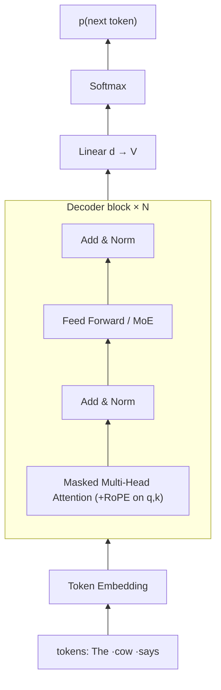

# 02 · Theoretical Foundations of Language Modelling (28 Oct)

> [!abstract] The lecture in one picture
> To predict the next token a model needs five things, and each has its own part of the transformer:
>
> | Need | Example | Part |
> |---|---|---|
> | What each piece means | ·cow is an animal; ·bank is money or river | **token embedding** |
> | How the pieces relate | "the cow says ___": cow shapes what says means | **(masked multi-head) attention** |
> | Where each piece stands | the cat sits on the table ≠ the table sits on the cat | **positional encoding** (RoPE) |
> | What the world knows | "the Eiffel Tower is in ___": no word says Paris | **feed-forward** (+ MoE) |
> | What comes next | a probability for every token | **linear + softmax** |
>
> Plus the glue: **Add & Norm** (residual stream + LayerNorm) and **N stacked decoder blocks**.

## Interactive page (5w1h)

<iframe src="https://5w1h.academy/introduction-to-generative-ai/module-01/language-modelling/#sec:attention" width="100%" height="750" style="border:1px solid #8884; border-radius:8px;"></iframe>

> [!tip] Section links
> [Neural networks](https://5w1h.academy/introduction-to-generative-ai/module-01/language-modelling/#sec:neural-networks) · [Embeddings](https://5w1h.academy/introduction-to-generative-ai/module-01/language-modelling/#sec:embeddings) · [Attention](https://5w1h.academy/introduction-to-generative-ai/module-01/language-modelling/#sec:attention) · [Queries & keys](https://5w1h.academy/introduction-to-generative-ai/module-01/language-modelling/#sec:queries-keys) · [Values](https://5w1h.academy/introduction-to-generative-ai/module-01/language-modelling/#sec:values) · [In matrices](https://5w1h.academy/introduction-to-generative-ai/module-01/language-modelling/#sec:attention-matrices) · [Scores & weights](https://5w1h.academy/introduction-to-generative-ai/module-01/language-modelling/#sec:attention-weights) · [Masked attention](https://5w1h.academy/introduction-to-generative-ai/module-01/language-modelling/#sec:masked-attention) · [Multi-head](https://5w1h.academy/introduction-to-generative-ai/module-01/language-modelling/#sec:multi-head) · [Position](https://5w1h.academy/introduction-to-generative-ai/module-01/language-modelling/#sec:position) · [RoPE](https://5w1h.academy/introduction-to-generative-ai/module-01/language-modelling/#sec:rope) · [Feed forward](https://5w1h.academy/introduction-to-generative-ai/module-01/language-modelling/#sec:feed-forward) · [Add & Norm](https://5w1h.academy/introduction-to-generative-ai/module-01/language-modelling/#sec:add-norm) · [Linear & softmax](https://5w1h.academy/introduction-to-generative-ai/module-01/language-modelling/#sec:head)
>
> This page has static figures only. For things to play with (softmax temperature/√dₖ, the causal mask, RoPE angles) open the **Attention**, **RoPE** and **LayerNorm** tabs of [[GenAI Lab|the interactive lab]].

---

## 0 · Neural network recap (shapes)

A network is a function $\hat y=f(x;\theta)$. ① initialise $\theta$ randomly → ② train with backpropagation (forward → loss → backward → each weight steps against its gradient) → ③ inference on new inputs.

Tensors by number of axes: scalar `()`, vector `(d)`, matrix `(n, d)`, tensor `(B, n, d)` = **B**atch × **n** tokens × **d** numbers per token. In the toy example "the cow says ___" with $n=3$ tokens of width 2: $X$ is (3,2), $W_1^\top$ is (2,2), $W_2^\top$ is (2,1), output $\hat Y$ is (3,1): **one prediction per position** ("is the next word moo?" at *every* word).

> [!example]+ Slide 10
> ![[GenAI-L2-slajd10.png|760]]

## 1 · Embedding

Token → token ID → **row** of the embedding table $E\in\mathbb{R}^{V\times d_{model}}$. Qwen3-0.6B: $V$ = 151,936 rows, $d_{model}$ = 1,024. It is a lookup; it does not look at neighbours; it is learned during training like every other weight.

> [!example]+ Slide 14
> ![[GenAI-L2-slajd14.png|760]]

## 2 · Attention: the core

**Goal:** compute *how much* (weights) and *how* (values) each token should shift the representation of every other token.

**Why not just the dot product of embeddings?** The dot product $a\cdot b=\lVert a\rVert\lVert b\rVert\cos\varphi$ measures *similarity*, but relevance ≠ similarity ("purple" is relevant to "cow" although they are not similar). So we first project into a learned **query–key space**.

### Step by step with shapes (one head, $n$ tokens)

| Step | Formula | Shape | Plain words |
|---|---|---|---|
| input | $X$ | $n\times d_{model}$ | one row per token (embedding, + position for some PE types) |
| queries | $Q=XW^Q$ | $n\times d_k$ | what each token is looking for |
| keys | $K=XW^K$ | $n\times d_k$ | what each token offers to be found by |
| values | $V=XW^V$ | $n\times d_v$ | *how* a token moves another one, kept separate from where it sits in meaning space |
| scores | $S=QK^\top$ | $n\times n$ | $s_{ij}=q_i\cdot k_j$ = how much word $j$ shapes the meaning of word $i$ |
| scale | $S/\sqrt{d_k}$ | $n\times n$ | same order, smaller range |
| mask (decoder) | $S/\sqrt{d_k}+M$ | $n\times n$ | $M_{ij}=-\infty$ for $j>i$ (future), 0 otherwise |
| weights | $\alpha=\text{softmax}_{\text{row}}(\cdot)$ | $n\times n$ | each row: numbers in [0,1] that sum to 1 |
| output | $\alpha V$ | $n\times d_v$ | $\text{out}_i=\sum_j\alpha_{ij}v_j$: weighted mix of values |

$$\text{Attention}(Q,K,V)=\text{softmax}\!\left(\frac{QK^\top}{\sqrt{d_k}}+M\right)V$$

> [!question] Which index is which? (the most common confusion)
> **Row $i$** = the token being updated (the *query*, "me"). **Column $j$** = the token being looked at (the *key/value*, "the one I attend to"). Softmax runs **along a row** (over $j$), so each token's weights over all others sum to 1. The mask kills columns $j>i$ in row $i$.

> [!example]+ Slides 18, 20
> ![[GenAI-L2-slajd18.png|760]]
>
> ![[GenAI-L2-slajd20.png|760]]

### Why divide by $\sqrt{d_k}$?

If the entries of $q$ and $k$ are roughly independent with variance 1, then $q\cdot k$ is a sum of $d_k$ terms, so its **variance grows like $d_k$** and its standard deviation like $\sqrt{d_k}$. Dividing by $\sqrt{d_k}$ keeps scores in a range where softmax is not saturated. With $d_k=64$: divide by 8 (slide: scores ÷ 8 → −5.6 … 5.6).

Without scaling: big scores → softmax gives one token ≈ all the weight and the rest ≈ 0 → gradients through softmax ≈ 0 → learning stalls. Scaling **keeps the order** of the scores (it's a positive constant), and it is *not* what makes the row sum to 1 (softmax does that). It has nothing to do with sequence length $n$.

> [!example]+ Slide 22
> ![[GenAI-L2-slajd22.png|760]]

<iframe src="https://jerzyszyjut.github.io/notes/university/notes/genai/genai-lab.htm#attention" width="100%" height="860" loading="lazy" style="border:1px solid #8884; border-radius:8px;"></iframe>

*Interactive: **Attention** tab of the [[GenAI Lab]] · [[genai-lab.htm|open it full screen]]*

### Softmax

$$\text{softmax}(s)_j=\frac{e^{s_j}}{\sum_i e^{s_i}}$$

- outputs in (0,1), sum to 1, keeps the order; adding the same constant to all $s_j$ changes nothing.
- $e^{-\infty}=0$, which is why the mask uses $-\infty$ **before** softmax: masked positions get exactly 0 and the remaining weights still sum to 1. Setting weights to 0 *after* softmax would leave rows summing to < 1.

> [!example]+ Slide 23
> ![[GenAI-L2-slajd23.png|760]]

### Masked (causal) attention

When learning $p(x_t\mid x_1,\dots,x_{t-1})$, each prediction may only use tokens **up to and including itself**. The mask makes position $t$ see exactly what it would see during generation, so **training computes all positions in parallel** in one pass (no loop over tokens), and the sum of all per-position losses = the chain-rule log-likelihood.

> [!example]+ Slide 27
> ![[GenAI-L2-slajd27.png|760]]

### Multi-head attention

Cut $Q,K,V$ into $h$ heads of width $d_{model}/h$; each head runs attention on its slice (its own "perspective", e.g. one head for syntax, one for coreference); **concatenate** the $h$ outputs (back to $d_{model}$) and mix with $W^O$. Original transformer: $d_{model}=512$, $h=8$, $d_k=d_v=64$. Cost ≈ one big head of the same total width.

```python
d_model, d_k = 512, 64
W_Q = nn.Linear(d_model, d_k, bias=False)   # same for W_K, W_V
Q, K, V = W_Q(x), W_K(x), W_V(x)            # [n, d_k] each
scores = Q @ K.T / math.sqrt(d_k)           # [n, n]
weights = scores.softmax(dim=-1)            # each row sums to 1
out = weights @ V                           # [n, d_k]
```

> [!summary] The 7 steps (slide)
> 1 make $Q,K,V$ · 2 score each query against each key · 3 divide by $\sqrt{d_k}$ · 4 in the decoder hide the future ($-\infty$ above the diagonal) · 5 softmax rows → weights summing to 1 · 6 weighted sum of values · 7 do it in $h$ heads, concatenate, project with $W^O$.

> [!example]+ Slide 28
> ![[GenAI-L2-slajd28.png|760]]

## 3 · Position: attention alone has no order

Attention is built from **pairs** ($q_i\cdot k_j$); the indices $i,j$ only pair words up. So without positional information and without a mask: shuffle the input → the outputs come out shuffled the same way:

$$\text{Attention}(PX)=P\cdot\text{Attention}(X)\qquad P=\text{permutation matrix}$$

"dog bites man" and "man bites dog": **dog gets the same output vector in both**, in every layer. Stacking layers doesn't help; adding the *same* vector to every token doesn't help; token IDs say *which* token, not *where*.

> [!note] Subtle point not stressed on the slides
> With a **causal mask**, attention is no longer permutation-equivariant: token 1 can only see itself, token 5 sees five tokens, so the model *can* infer some order (and "NoPE" models without positional encodings exist). The exam question specified "without a mask" for this reason.

> [!example]+ Slide 32
> ![[GenAI-L2-slajd32.png|760]]

### Absolute vs relative

| Method | How | + | − |
|---|---|---|---|
| **Learned absolute** (GPT-2) | table $P$ with one learned row per position (1,024 rows × 768), **added** to $X$ | model learns what positions should be | fixed max length (no row 1,024); late rows trained rarely |
| **Sinusoidal absolute** (original) | $PE(pos,2i)=\sin(pos/10000^{2i/d})$, $PE(pos,2i+1)=\cos(\cdot)$, **added** to $X$ | nothing to learn, any position; "$k$ positions later" = same fixed rotation of the vector | relative position only **implicit** |
| **Relative bias** (T5, ALiBi) | add a number $b_{j-i}$ per **distance** to the **scores**: $S+B$ | directly relative | – |
| **RoPE** (Llama, Qwen) | **rotate** $q$ and $k$ by an angle proportional to the position | relative by construction; no extra parameters | needs care to extend context (→ YaRN, TP II) |

**Sinusoidal variables:** $pos$ = position (0,1,2,…), $i$ = index of the sin/cos **pair** of dimensions, $d$ = model width. Each pair is a wave over positions; low $i$ = fast wave, high $i$ = slow wave ("slower and slower to the right").

> [!example]+ Slides 35, 36
> ![[GenAI-L2-slajd35.png|760]]
>
> ![[GenAI-L2-slajd36.png|760]]

### RoPE in detail

$$R(m)=\text{diag}\big(R(m\theta_1),R(m\theta_2),\dots,R(m\theta_{d/2})\big),\qquad \theta_i=b^{-2(i-1)/d}$$

| Variable | Meaning |
|---|---|
| $m$ | position of the token (query at $m$, key at $n$ – here $n$ is a *position*) |
| $i$ | which **pair** of dimensions (1 … $d/2$); dims 1–2 are pair 1 |
| $\theta_i$ | angle turned **per position** by pair $i$; pair 1: $\theta_1=b^0=1$ rad, later pairs exponentially slower |
| $b$ | base: 10,000 (orig., Llama 2) · 500,000 (Llama 3, Olmo 3) · 1,000,000 (Qwen3) |
| $d$ | dimension of the vectors being rotated (the **head** dimension) |
| $R(\phi)$ | 2×2 rotation $\begin{pmatrix}\cos\phi&-\sin\phi\\ \sin\phi&\cos\phi\end{pmatrix}$ |

Key identity: $(R(m)q)^\top(R(n)k)=q^\top R(n-m)\,k$. The score only depends on the **distance** $n-m$: ·says at 3 vs ·cow at 2 gives the same angle difference as positions 13 and 12.

- Only **$q$ and $k$** are rotated, **not $v$** (position should affect *how much* to attend, not *what* is carried).
- Applied **inside every attention layer**, not added once at the input.
- **Different speeds per pair**: fast pairs resolve nearby order (a full turn every few tokens), slow pairs distinguish far-apart positions without wrapping around. One speed alone fails: large steps wrap around (position 7 = position 1 after 360°), tiny steps make neighbours indistinguishable.

> [!example]+ Slides 38, 39, 40
> ![[GenAI-L2-slajd38.png|760]]
>
> ![[GenAI-L2-slajd39.png|760]]
>
> ![[GenAI-L2-slajd40.png|760]]

<iframe src="https://jerzyszyjut.github.io/notes/university/notes/genai/genai-lab.htm#rope" width="100%" height="860" loading="lazy" style="border:1px solid #8884; border-radius:8px;"></iframe>

*Interactive: **RoPE & YaRN** tab of the [[GenAI Lab]] · [[genai-lab.htm|open it full screen]]*

## 4 · Feed-forward: knowledge

"The Eiffel Tower is in ___": attention can only combine what is **in** the sentence; "Paris" is in no piece. The FFN applies **the same 2-layer network to each token on its own**:

$$\text{FFN}(x)=\text{ReLU}(xW_1)W_2,\qquad W_1: d_{model}\to d_{ff},\ W_2: d_{ff}\to d_{model},\ d_{ff}=4\,d_{model}$$

512 → 2,048 → 512 in the original. It holds **most of a block's weights** (2·512·2,048 ≈ 2.1M vs 4·512² ≈ 1.05M for attention) and is seen as the main store of world knowledge. Modern models use the gated **SwiGLU** variant.

**Mixture of experts (MoE):** replace the one FFN by many small expert FFNs + a **router** that picks $k$ experts **per token**; only those run, and their outputs are mixed by the router probabilities: $y=p_2E_2(x)+p_5E_5(x)$. More parameters (knowledge), same compute per token.

> [!example]+ Slides 44, 47
> ![[GenAI-L2-slajd44.png|760]]
>
> ![[GenAI-L2-slajd47.png|760]]

## 5 · Add & Norm: keeping it trainable

**Residual connection:** $x+\text{Attention}(x)$, $x+\text{FFN}(x)$: each sublayer *adds* what it found to the token's vector, which is carried straight up: the **residual stream**. Gradients flow through the identity path; deep stacks stay trainable.

**LayerNorm**, per token vector (over its $d$ numbers, *not* across the batch or across tokens):

$$\text{LayerNorm}(x)=\gamma\odot\frac{x-\mu}{\sqrt{\sigma^2+\epsilon}}+\beta,\quad \mu=\tfrac1d\sum_k x_k,\quad \sigma^2=\tfrac1d\sum_k(x_k-\mu)^2$$

$\epsilon\approx10^{-6}$ (never divide by 0), $\gamma,\beta$ learned per dimension (start 1 and 0). Purpose: every token's numbers back in the same range after every sublayer, however deep → stable training. Qwen3 uses **RMSNorm** (no mean subtraction, no $\beta$) and QK-norm. Original paper: post-norm $\text{Norm}(x+\text{Sub}(x))$; modern models (TP I recap): **pre-norm** $x+\text{Sub}(\text{Norm}(x))$.

> [!example]+ Slides 53, 54
> ![[GenAI-L2-slajd53.png|760]]
>
> ![[GenAI-L2-slajd54.png|760]]

<iframe src="https://jerzyszyjut.github.io/notes/university/notes/genai/genai-lab.htm#layernorm" width="100%" height="860" loading="lazy" style="border:1px solid #8884; border-radius:8px;"></iframe>

*Interactive: **LayerNorm** tab of the [[GenAI Lab]] · [[genai-lab.htm|open it full screen]]*

## 6 · Linear + softmax: what comes next

After the last block: a vector of $d$ (1,024) numbers per token, but we need **one number per vocabulary entry** (151,936), and they must be **probabilities**.

1. **Linear** $W_{out}\in\mathbb{R}^{d\times V}$ → logits (any real number, negative too). In Qwen3-0.6B it **shares** the embedding table (weight tying).
2. **Softmax** row by row → a distribution over the next token at **every** position.

Training scores **every** position (row $t$ predicts token $t+1$); generation uses **only the last row**.

> [!example]+ Slide 50
> ![[GenAI-L2-slajd50.png|760]]

## The full decoder-only model



> [!example]+ Slide 56
> ![[GenAI-L2-slajd56.png|760]]

---

## Exam traps from this lecture

- Only **attention** mixes information across tokens. Embedding, FFN, LayerNorm, final linear are all **per token**.
- $\sqrt{d_k}$: because scores grow with $d_k$ (vector length), **not** with $n$; prevents saturation/vanishing gradients; keeps the order; softmax (not the scaling) makes rows sum to 1.
- Mask with $-\infty$ **before** softmax → exactly 0 weight, rows still sum to 1; enables **parallel** training.
- No PE + no mask → permutation equivariant; same output vector for "dog" in both orders.
- RoPE rotates $q,k$ only, depends on relative distance, different frequency per pair, base $b$.
- FFN ≈ knowledge, holds most parameters; MoE router picks experts **per token**.
- LayerNorm normalises **within one token's vector**.
- Generation uses only the last row of logits; training uses all rows.


## Test questions for this lecture (22)

> [!info] Same format as the test
> 0 to 4 options can be correct. Tick, then open the answer. **+1.5 ÷ n** per correct tick, **−0.75** per wrong tick, never below 0; no correct option → no tick = 1.5.
> The same questions, mixed across lectures and timed, are in the mock tests ([[_GenAI Test 1 - Start Here|Start Here]]) and in the Quiz tab of the [[GenAI Lab]].

### Official Q2 · attention alone: no order
<small>from [[GenAI - Official Example Questions|Official]]</small>

**Attention without positional encoding and without a mask reads “dog bites man” and “man bites dog”. Each word is one token. What is true?**

- [ ] **A** The word dog gets the same output vector in both
- [ ] **B** Adding the same vector to every embedding tells the two apart
- [ ] **C** Stacking more of these attention layers tells the two apart
- [ ] **D** The token IDs tell the model the order of the words

> [!success]- Answer: A
> Attention only compares pairs of tokens. Change the order of the input and you get the same outputs in the new order, in every layer. A vector added to every token is the same everywhere, and a token ID says which token it is, not where it stands.
> *Theoretical Foundations of Language Modelling · attention alone: no order*

### Official Q5 · softmax, and why the scores are scaled
<small>from [[GenAI - Official Example Questions|Official]]</small>

**Why are the attention scores divided by √dₖ before the softmax?**

- [ ] **A** Without it, large scores give one token almost all the weight
- [ ] **B** Without it, almost no gradient flows back through the softmax
- [ ] **C** Without it, the scores grow with the length of the sequence
- [ ] **D** Without it, the weights in a row do not add up to 1

> [!success]- Answer: A, B
> Scores grow with dₖ, the length of q and k, not with the length of the sequence. With large scores, softmax gives one token nearly everything and the rest almost 0, so there is almost no gradient. Dividing keeps the order of the scores; softmax itself makes the weights add up to 1.
> *Theoretical Foundations of Language Modelling · softmax, and why the scores are scaled*

### Official Q7 · masked attention: the chain rule inside attention
<small>from [[GenAI - Official Example Questions|Official]]</small>

**In masked self-attention, the scores for later tokens are set to −∞ before the softmax. What is true?**

- [ ] **A** The weights for later tokens come out as exactly 0
- [ ] **B** The weights in each row still add up to 1
- [ ] **C** Setting those weights to 0 after the softmax would give the same result
- [ ] **D** Because of the mask, training has to go through the tokens one after the other

> [!success]- Answer: A, B
> e^−∞ = 0, so the softmax gives later tokens no weight and shares the whole 1 among the tokens up to here. Zeroing the weights after the softmax leaves rows that add up to less than 1. The mask is what lets training run every position at once: each sees exactly what it would see while generating.
> *Theoretical Foundations of Language Modelling · masked attention: the chain rule inside attention*

### Mock A Q4 · embedding table
<small>from [[GenAI - Mock Test A|Mock A]]</small>

**Qwen3-0.6B-Base has an embedding table with 151,936 rows of 1,024 numbers. What is true?**

- [ ] **A** Each of the 1,024 dimensions stands for a nameable property such as “animal” or “dairy”
- [ ] **B** The table stays at its random initial values; only attention and feed-forward weights are trained
- [ ] **C** There is one row per token ID in the vocabulary
- [ ] **D** Looking up ·cow returns row 19362, the same vector in every sentence

> [!success]- Answer: C, D
> The embedding is a lookup: token ID → row. It is learned like every other weight. Real dimensions have no names; the animal / royalty columns on the slide were an illustration.
> *Theoretical Foundations of Language Modelling · embedding table*

### Mock A Q5 · scaling by √dk
<small>from [[GenAI - Mock Test A|Mock A]]</small>

**A head has dₖ = 64, so its scores are divided by 8 before the softmax. What is true?**

- [ ] **A** The division can change which key gets the highest weight
- [ ] **B** Without it, the spread of the scores grows with dₖ, the length of q and k
- [ ] **C** For dₖ = 256 the matching divisor would be 16
- [ ] **D** After the softmax, the weights in each row still add up to 1

> [!success]- Answer: B, C, D
> If q and k have entries of variance 1, q · k has variance dₖ, so its spread grows like √dₖ; dividing by √dₖ undoes that (√256 = 16). Dividing by a positive constant keeps the order of the scores; softmax makes the row sum to 1.
> *Theoretical Foundations of Language Modelling · scaling by √dk*

### Mock A Q6 · masked attention
<small>from [[GenAI - Mock Test A|Mock A]]</small>

**A decoder is trained with a causal mask on rows of 4,096 tokens. What is true?**

- [ ] **A** The token at position 1 attends only to itself
- [ ] **B** Training has to loop over the positions one after the other
- [ ] **C** The prediction at position 10 may use token 11
- [ ] **D** All 4,096 next-token predictions of a row are computed in one forward pass

> [!success]- Answer: A, D
> The mask puts −∞ above the diagonal, so each position sees exactly what it would see while generating. That is what makes it safe to compute every position in parallel. Position 1 has only itself to look at.
> *Theoretical Foundations of Language Modelling · masked attention*

### Mock A Q7 · RoPE
<small>from [[GenAI - Mock Test A|Mock A]]</small>

**What is true about rotary position embeddings (RoPE)?**

- [ ] **A** For given q and k, the score between positions m and n depends only on n − m
- [ ] **B** Queries and keys are rotated, values are not
- [ ] **C** Every pair of dimensions turns by the same angle per position
- [ ] **D** The rotation vector is added once to the embeddings, before the first block

> [!success]- Answer: A, B
> (R(m)q)ᵀ(R(n)k) = qᵀR(n − m)k: a relative score. RoPE is applied to q and k inside every attention layer, not added at the input. Each pair has its own speed θᵢ = b^(−2(i−1)/d): fast pairs for nearby order, slow pairs for long distances.
> *Theoretical Foundations of Language Modelling · RoPE*

### Mock A Q8 · LayerNorm
<small>from [[GenAI - Mock Test A|Mock A]]</small>

**LayerNorm(x) = γ ⊙ (x − μ) / √(σ² + ε) + β. What is true?**

- [ ] **A** γ and β are learned, one value per dimension
- [ ] **B** ε is a learned bias that shifts the output
- [ ] **C** μ is the mean over all tokens in the batch
- [ ] **D** μ and σ² are computed over the d numbers of one token’s vector

> [!success]- Answer: A, D
> LayerNorm normalises each token’s own vector. ε ≈ 10⁻⁶ only avoids dividing by 0; β is the learned shift. γ and β start at 1 and 0 and are learned per dimension.
> *Theoretical Foundations of Language Modelling · LayerNorm*

### Mock B Q4 · mask without positional encoding
<small>from [[GenAI - Mock Test B|Mock B]]</small>

**A decoder has causal masked attention but no positional encoding. It reads “dog bites man” and “man bites dog” (one token per word). What is true?**

- [ ] **A** The output for the first token depends only on that token
- [ ] **B** The outputs are the same vectors as before, only in permuted order
- [ ] **C** “dog” gets the same output vector in both sentences
- [ ] **D** In principle the model can tell positions apart, since each position sees a different number of tokens

> [!success]- Answer: A, D
> The permutation argument holds only without the mask. With it, “dog” first sees only itself; “dog” last sees all three words. That is why the example test said: without positional encoding and without a mask.
> *Theoretical Foundations of Language Modelling · mask without positional encoding*

### Mock B Q5 · softmax
<small>from [[GenAI - Mock Test B|Mock B]]</small>

**One row of scaled scores is s = (2, 1, 0). What is true about the softmax weights?**

- [ ] **A** The largest score gets the largest weight
- [ ] **B** Adding 5 to every score changes the weights
- [ ] **C** They add up to 1
- [ ] **D** Multiplying every score by 10 brings the weights closer to (1, 0, 0)

> [!success]- Answer: A, C, D
> softmax(s)ⱼ = e^sⱼ / Σ e^sᵢ: positive, sums to 1, keeps the order. A constant shift cancels out. Larger scores sharpen it toward one-hot: exactly why scores are divided by √dₖ.
> *Theoretical Foundations of Language Modelling · softmax*

### Mock B Q6 · shapes in attention
<small>from [[GenAI - Mock Test B|Mock B]]</small>

**X has shape n × d_model; W^Q and W^K are d_model × dₖ; W^V is d_model × d_v. What is true?**

- [ ] **A** QKᵀ has shape dₖ × dₖ
- [ ] **B** QKᵀ has shape n × n
- [ ] **C** The output softmax(QKᵀ/√dₖ)V has shape n × d_v
- [ ] **D** Row i of the weights says how much token i takes from each token j

> [!success]- Answer: B, C, D
> Q and K are n × dₖ, so QKᵀ is n × n: a score for every pair. Softmax runs along each row (over j). Weights (n × n) times V (n × d_v) give one new vector per token.
> *Theoretical Foundations of Language Modelling · shapes in attention*

### Mock B Q7 · positional encodings
<small>from [[GenAI - Mock Test B|Mock B]]</small>

**Learned absolute vs sinusoidal positional encodings. What is true?**

- [ ] **A** With sinusoidal encodings, k positions later is the same fixed turn of the vector from any position
- [ ] **B** A learned table with 1,024 rows has no vector for position 1,024
- [ ] **C** Sinusoidal encodings have no parameters to learn
- [ ] **D** Both are applied by rotating queries and keys

> [!success]- Answer: A, B, C
> GPT-2’s learned table: fixed context length, late rows seen only in long texts. Sinusoidal: computed for any position; distances only implicit. Both are added to the token vectors; rotating q and k is RoPE.
> *Theoretical Foundations of Language Modelling · positional encodings*

### Mock B Q8 · output layer
<small>from [[GenAI - Mock Test B|Mock B]]</small>

**After the last block, “The cow says” gives a matrix H of shape 3 × 1,024 in Qwen3-0.6B. What is true?**

- [ ] **A** In Qwen3-0.6B the output layer shares its weights with the embedding table
- [ ] **B** To generate the next token, only the last row is needed
- [ ] **C** A linear layer maps each row to 151,936 logits
- [ ] **D** Softmax turns each row into a distribution over the next token

> [!success]- Answer: A, B, C, D
> Linear d → V gives one number per vocabulary entry; softmax makes them probabilities. Training scores every row (each predicts the token after it); generation uses only the last. Qwen3-0.6B ties the head to the embedding table.
> *Theoretical Foundations of Language Modelling · output layer*

### Mock C Q4 · which parts mix tokens
<small>from [[GenAI - Mock Test C|Mock C]]</small>

**In a decoder-only transformer, which parts let a token’s vector take in information from other positions?**

- [ ] **A** The feed-forward layer
- [ ] **B** LayerNorm
- [ ] **C** The token embedding
- [ ] **D** Masked multi-head attention

> [!success]- Answer: D
> Only attention compares and mixes tokens. Embedding (a lookup), feed-forward (each token alone) and LayerNorm (over one token’s own numbers) all work per token.
> *Theoretical Foundations of Language Modelling · which parts mix tokens*

### Mock C Q5 · dₖ and saturation
<small>from [[GenAI - Mock Test C|Mock C]]</small>

**Two heads skip the √dₖ scaling. Head A has dₖ = 16, head B has dₖ = 1,024; q and k have entries of variance 1. What is true?**

- [ ] **A** Head B’s scores typically spread about 8 times wider than head A’s
- [ ] **B** Head B’s weights no longer add up to 1 per row
- [ ] **C** Less gradient flows back through head B’s softmax
- [ ] **D** Head B’s softmax is more likely to give one token nearly all the weight

> [!success]- Answer: A, C, D
> Standard deviation √dₖ: √1,024 / √16 = 32 / 4 = 8. Wide scores saturate the softmax: nearly one-hot, gradients ≈ 0. The softmax still sums to 1 in every case.
> *Theoretical Foundations of Language Modelling · dₖ and saturation*

### Mock C Q6 · the causal mask
<small>from [[GenAI - Mock Test C|Mock C]]</small>

**A causal mask M is added to the scaled scores before the softmax. What is true?**

- [ ] **A** The diagonal is masked too, so a token cannot attend to itself
- [ ] **B** The mask is applied to V rather than to the scores
- [ ] **C** M holds −∞ strictly above the diagonal and 0 elsewhere
- [ ] **D** After the softmax, the first row is (1, 0, 0, …)

> [!success]- Answer: C, D
> Each token may see the tokens before it and itself. Row 1 has only itself, so all its weight goes there. The mask acts on the scores; e^(−∞) = 0 gives exactly zero weight to the future.
> *Theoretical Foundations of Language Modelling · the causal mask*

### Mock C Q7 · Add & Norm
<small>from [[GenAI - Mock Test C|Mock C]]</small>

**A block computes x + Attention(Norm(x)), then x + FeedForward(Norm(x)). What is true?**

- [ ] **A** Attention adds what it found to the token’s vector, which is carried straight up
- [ ] **B** The norm is computed across all tokens of the sequence
- [ ] **C** The residual path helps gradients flow through deep stacks
- [ ] **D** Qwen3’s RMSNorm skips subtracting the mean

> [!success]- Answer: A, C, D
> This is the pre-norm residual stream. The norm works on each token’s own vector. RMSNorm only divides by the root mean square (no μ, no β).
> *Theoretical Foundations of Language Modelling · Add & Norm*

### Mock C Q8 · RoPE frequencies
<small>from [[GenAI - Mock Test C|Mock C]]</small>

**RoPE turns pair i by θᵢ = b^(−2(i−1)/d) per position. What is true?**

- [ ] **A** b sets the maximum number of tokens the model can read
- [ ] **B** Qwen3 uses b = 1,000,000; the original value is 10,000
- [ ] **C** A larger base b makes the slowest pairs turn even more slowly
- [ ] **D** Pair 1 turns fastest

> [!success]- Answer: B, C, D
> θ₁ = b⁰ = 1 rad per position; later pairs are exponentially slower, more so for larger b. The base is not a hard length limit; context length depends on what was trained (and stretching like YaRN).
> *Theoretical Foundations of Language Modelling · RoPE frequencies*

### Extra Q4 · multi-head attention
<small>from [[GenAI - Extra Questions|Extra]]</small>

**The original transformer has d_model = 512 and h = 8 heads. What is true?**

- [ ] **A** Each head works with queries and keys of length 64
- [ ] **B** The heads’ outputs are concatenated and multiplied by W^O
- [ ] **C** 8 heads cost about 8× the compute of one head of width 512
- [ ] **D** Each head sees only one eighth of the tokens

> [!success]- Answer: A, B
> Q, K and V are cut into h slices of d_model / h = 64; every head sees all tokens, from its own perspective. Total width stays 512, so the cost is about that of one wide head.
> *Theoretical Foundations of Language Modelling · multi-head attention*

### Extra Q5 · feed-forward
<small>from [[GenAI - Extra Questions|Extra]]</small>

**What is true about the feed-forward layer in a decoder block?**

- [ ] **A** In a mixture of experts, the router picks experts once per sequence
- [ ] **B** It applies the same network to each token on its own
- [ ] **C** It holds most of a block’s weights
- [ ] **D** It is where information from other positions is combined

> [!success]- Answer: B, C
> 512 → 2,048 → 512: 2 · 512 · 2,048 ≈ 2.1M weights vs 4 · 512² ≈ 1.05M for attention. It turns what attention gathered into new features (e.g. Eiffel Tower → Paris). MoE routing is per token.
> *Theoretical Foundations of Language Modelling · feed-forward*

### Extra Q6 · values
<small>from [[GenAI - Extra Questions|Extra]]</small>

**Why does attention use a learned value projection, v = x W^V?**

- [ ] **A** W^V is applied to the attention weights after the softmax
- [ ] **B** Using the embedding itself as the value can also work
- [ ] **C** So that how a token shifts others can differ from where it sits in meaning space
- [ ] **D** Without W^V, the attention weights could not be computed

> [!success]- Answer: B, C
> Weights come from Q and K; values decide what is moved. The simplest shift uses x itself, and that can work (He & Hofmann, ICLR 2024), but a separate projection usually does better. V = X W^V, then weights × V.
> *Theoretical Foundations of Language Modelling · values*

### Extra Q7 · two meanings of bank
<small>from [[GenAI - Extra Questions|Extra]]</small>

**“He sat on the river bank” vs “She put her money in the bank”. What is true about ·bank after the last layer of Qwen3-0.6B?**

- [ ] **A** The two vectors differ
- [ ] **B** The difference comes from attention to the other words
- [ ] **C** The embedding lookups already differ
- [ ] **D** The feed-forward layers alone could produce the difference, without attention

> [!success]- Answer: A, B
> Same lookup row in both; after 28 layers cosine similarity 0.79. Only attention brings in the neighbours; the feed-forward sees each token alone.
> *Theoretical Foundations of Language Modelling · two meanings of bank*

<!-- end of test questions -->

Related: [[GenAI - Glossary|Glossary: symbols & variables]] · [[2026-10-21 - Introduction to Generative AI|Introduction to Generative AI]] · [[2026-11-04 - Training Paradigms I|Training Paradigms I]] · [[GenAI Lab]]
