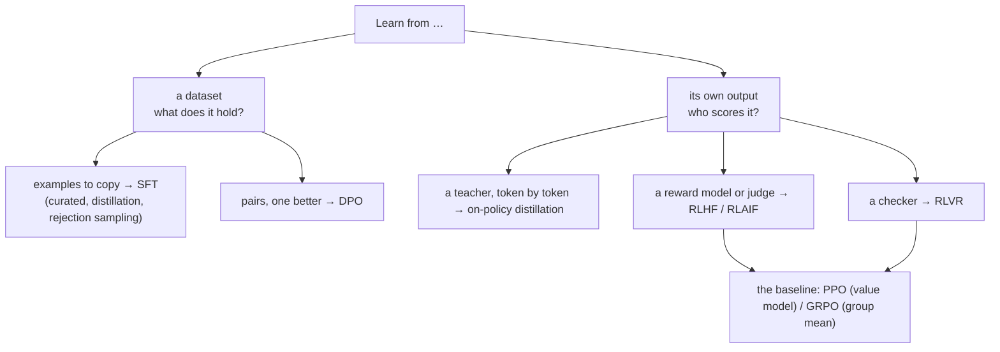

# 04 · Training Paradigms II (11 Nov): mid-training & post-training

> [!abstract] The story
> Pre-training produced a base model that continues text. **Mid-training** (step 4) does three things at the end of pre-training: **① cool down the learning rate, ② finish on the best data, ③ extend the context** (4,096 → 1M). **Post-training** (step 5) turns the base model into an assistant, either by learning from **a dataset** (SFT: examples to copy; DPO: pairs, one better) or from **its own output**, scored by a **teacher** (on-policy distillation), a **reward model / judge** (RLHF, RLAIF) or a **checker** (RLVR). The RL methods differ in where the **baseline** comes from: **PPO** (value model) vs **GRPO** (group mean).

> [!info] No 5w1h page for this lecture
> Part of the long-context material (attention cost, KV cache, GQA, MLA, "four ways") is on the [Training Paradigms 5w1h page](https://5w1h.academy/introduction-to-generative-ai/module-01/training-paradigms/#sec:context-later), embedded below. For everything else, use the **KV cache**, **DPO / RM**, **KL**, **PPO / GRPO** and **YaRN** tabs of [[GenAI Lab]].

<iframe src="https://5w1h.academy/introduction-to-generative-ai/module-01/training-paradigms/#sec:context-later" width="100%" height="650" style="border:1px solid #8884; border-radius:8px;"></iframe>

---

# Part A · Mid-training

## A1 · Cool down the learning rate

With a warmup–stable–decay schedule the loss landscape picture is: **travel** (high LR, big jumps across the landscape) → **bounce** (still high LR, bouncing between the walls of a valley) → **settle** (LR decays → steps get small → slides to the bottom). The decay phase gives a big loss drop and is the natural place to switch data.

> [!example]+ Slide 39
> ![[GenAI-L4-slajd39.png|760]]

## A2 · Finish on the best data

The last, small slice of training uses a higher-quality mix: web, code, **maths**, **reasoning**, **Q&A**, PDFs, including **thinking traces** written as plain text, *without* chat format:

```
17 × 24 = ?
17 × 20 = 340, 17 × 4 = 68
340 + 68 = 408
check: 408 ÷ 24 = 17 ✓
answer: 408
```

Why: the model then already *sometimes* produces correct reasoning, and RL later only has to make the good behaviour more likely ("after mid-training: some ✓ → after RL: mostly ✓"). RL can only reinforce what the model can already sample.

> [!example]+ Slide 40
> ![[GenAI-L4-slajd40.png|760]]

## A3 · Extend the context: 4,096 → 1,000,000

Three obstacles, three fixes:

| Obstacle | Fix | When |
|---|---|---|
| **1 Attention**: $n\times n$ scores per layer (8 tokens → 64 scores; cost and memory grow **quadratically**) | make attention affordable (GQA, MLA, windows, sparse, linear) | **from the start** (architecture) |
| **2 Positions**: RoPE never saw angles beyond the training length | stretch the positions (YaRN) | **in mid-training** |
| **3 Training data**: very few long documents (most docs are ≤ 4K) | train on long rows, at the end | **in mid-training** |

> [!example]+ Slide 42
> ![[GenAI-L4-slajd42.png|760]]

### Excursus: attention cost and the KV cache

Training/prefill: $\text{softmax}(QK^\top/\sqrt{d_k})V$ with $Q,K \in \mathbb{R}^{n\times d_k}$ → an **$n\times n$** weight matrix per head and layer.

**Generation with a KV cache.** Generating token $t+1$ needs: the new token's $q$, scored against the $k$ of **every** earlier token, mixing their $v$.

| | What happens for each new token |
|---|---|
| ✓ | **only the new token** goes through all the layers (embedding, q/k/v, attention, FFN, next-token distribution) |
| ✓ | its **query** is compared with the **cached keys** of all earlier tokens (+ its own key) |
| ✓ | its **key and value** are **appended** to the cache for later tokens |
| ✗ | earlier tokens' keys/values are **never updated**: because of the causal mask, a token never sees later tokens, so its $k,v$ never change |

- **Prefill** = reading the prompt: all prompt tokens at once, in parallel (compute-bound) → fills the cache.
- **Decode** = writing: one token per step; each step must read **all weights + the whole cache** from memory → **memory-bound**.

**Cache size per token** (bf16 = 2 bytes):

$$\text{bytes/token}=2\,(\text{K and V})\times L\,(\text{layers})\times h_{kv}\,(\text{KV heads})\times d_{head}\times 2\,(\text{bytes})$$

Pilot with full multi-head attention: $2\cdot24\cdot16\cdot128\cdot2$ = 196,608 B ≈ **192 KiB per token** → at 1M tokens ≈ **200 GB** for one sequence. Hence:

**Grouped-query attention (GQA).** Several query heads **share** one K/V head. Slide: 8 query heads, 2 K/V groups → cache ÷ 4. Quality nearly unchanged. (MQA = all query heads share 1 K/V.)

**Multi-head latent attention (MLA, DeepSeek-V3).** Don't cache K and V; cache a small **latent** per token:

| Symbol | Meaning | DeepSeek-V3 size |
|---|---|---|
| $X$ | token vectors | $d_{model}$ = 7,168 |
| $W^{DKV}$ | **D**own-projection to the joint **K**V latent | 7,168 → 512 |
| $C = XW^{DKV}$ | the cached latent ($c_j$ for token $j$) | $d_c$ = **512** per token |
| $W^{UK}$, $W^{UV}$ | **U**p-projections that rebuild keys / values | 512 → $h\cdot d_{head}$ = 16,384 |
| $K = CW^{UK}$, $V=CW^{UV}$ | full keys and values, recomputed | 16,384 each |

Cache 512 numbers instead of 2 × 16,384 → **64× smaller**. Trick: $W^{UK}$ can be **absorbed into the query**: $q_t k_j^\top = (q_t W^{UK\top})\,c_j^\top$, so K never has to be materialised.

**Four ways to make long attention cheaper** (what each new token looks at):

| Way | Idea | Memory per new token |
|---|---|---|
| full attention | every earlier token, full K/V | grows with $n$, full size |
| **compress each token** | keep every token, but each one smaller (GQA, MLA) | grows with $n$, smaller |
| **look nearby** | sliding window: only the last $w$ tokens (usually mixed with some full-attention layers; Olmo 3 does this) | fixed: $w$ tokens |
| **squeeze, then select** | cheap look at compressed blocks, then full attention only to the few selected ones (sparse attention) | grows, but only a few read in full |
| **a fixed-size state** | linear attention / recurrent state that summarises everything so far | constant |

(Slide sources: MiniMax-M2, DeepSeek, Olmo 3, DeepSeek-V4, Kimi K3. Frontier models mix several of these across layers.)

> [!example]+ Slides 43, 44, 45, 46, 47
> ![[GenAI-L4-slajd43.png|760]]
>
> ![[GenAI-L4-slajd44.png|760]]
>
> ![[GenAI-L4-slajd45.png|760]]
>
> ![[GenAI-L4-slajd46.png|760]]
>
> ![[GenAI-L4-slajd47.png|760]]

<iframe src="https://jerzyszyjut.github.io/notes/university/notes/genai/genai-lab.htm#kvcache" width="100%" height="860" loading="lazy" style="border:1px solid #8884; border-radius:8px;"></iframe>

*Interactive: **KV cache** tab of the [[GenAI Lab]] · [[genai-lab.htm|open it full screen]]*

### Stretching the positions: YaRN

RoPE pair $i$ turns by $\theta_i=b^{-2(i-1)/d}$ per position. Olmo 3 7B ($b$ = 500,000, head dim 128 → 64 pairs), trained on 8K rows:

| Pair | Turns within 0–8K | Status during training | YaRN (8K → 64K, scale 8) |
|---|---|---|---|
| pair 1 (fastest) | 1,304 full turns | every angle seen many times | **unchanged** |
| pair 16 | 60 turns | every angle seen | unchanged |
| pair 24 | 12 turns | | ÷2.3 (partly) |
| pair 30 | 3.4 turns | | ÷5.2 (partly) |
| pair 48 (slow) | only **31°** | most angles **never seen** | **÷8** |

**Why:** at position 50K a slow pair would reach angles the model never saw → garbage. Dividing its speed by the scale factor 8 maps 0–64K into the angle range seen in 0–8K (**interpolation**). Fast pairs are left alone (they carry fine **local** order and have seen all angles anyway). Rule (YaRN default thresholds): pairs with > 32 turns in the training length: untouched; < 1 turn: ÷ scale; in between: blended. Olmo 3: 19 fast pairs untouched, 16 partly, 29 slow ÷8. (Plain *position interpolation* would divide **all** pairs by 8 → blurs nearby order.)

> [!example]+ Slide 48
> ![[GenAI-L4-slajd48.png|760]]

<iframe src="https://jerzyszyjut.github.io/notes/university/notes/genai/genai-lab.htm#rope" width="100%" height="860" loading="lazy" style="border:1px solid #8884; border-radius:8px;"></iframe>

*Interactive: **RoPE & YaRN** tab of the [[GenAI Lab]] · [[genai-lab.htm|open it full screen]]*

### Long rows, at the end (Olmo 3)

- Pre- and mid-training: rows of **8K**; long documents are cut across rows, so the model never sees one in one piece.
- Long-context stage: rows of **64K**; a 30K PDF fits in one piece for the first time; short docs fill the rest.
- Stage: **50B tokens**: **34%** long documents (8K–64K: PDFs, synthetic tasks) + **66%** the short mid-training mix "so short skills hold".
- **Intra-document masking**: in a packed row, put $-\infty$ **between documents** so each token only sees its own document (the mask becomes block-diagonal-causal). Unrelated docs in the same row would otherwise leak into each other.

Extension factors reported: Olmo 3 7B ×8 (1 step), DeepSeek-V3 ×32 (2 steps), Llama 3 ×16 (6 stages), GLM-5 ×6 (2 steps), DeepSeek-V4 ×256 to 1M **in pre-training**. 1M is today's frontier, reached with new attention.

> [!example]+ Slides 49, 50
> ![[GenAI-L4-slajd49.png|760]]
>
> ![[GenAI-L4-slajd50.png|760]]

---

# Part B · Post-training



> [!example]+ Slide 74
> ![[GenAI-L4-slajd74.png|760]]

## B1 · SFT: examples to copy

Ordinary next-token loss, on (prompt, answer) pairs. Where the answers come from:
- **curated dataset**: people write them,
- **distillation**: a stronger model writes them,
- **rejection sampling**: the policy writes several, the best are kept.

The model only learns to **imitate**; it never sees what a *bad* answer looks like.

## B2 · DPO: pairs, one better

**Where "chosen" comes from:** people compare (InstructGPT: rank 4–9 answers) · a model judges (Tülu 3: GPT-4o rates) · bigger model's answer wins (Olmo 3: Qwen3-32B's answer is "chosen" over Qwen3-0.6B's). **Labelled once: a fixed dataset** (offline, no sampling during training).

$$\mathcal{L}_{DPO}=-\log\sigma\Big(\beta\big[\underbrace{(\log p_{policy}(y^+)-\log p_{ref}(y^+))}_{\text{gain}^+}-\underbrace{(\log p_{policy}(y^-)-\log p_{ref}(y^-))}_{\text{gain}^-}\big]\Big)$$

| Variable | Meaning |
|---|---|
| $x$ | the prompt ("Why do cows moo?") |
| $y^+, y^-$ | chosen / rejected answer |
| $\log p(y)$ | **sum** of the token log-probs of the whole answer |
| $p_{policy}$ | model being trained |
| $p_{ref}$ | **frozen copy of the SFT model** |
| gain | how much more likely the policy makes an answer *than the reference does* |
| $\beta$ | 0.1. Plays the role of the KL weight from RLHF: **larger β → policy stays closer to the reference** (the loss is already satisfied by smaller log-ratio changes) |
| $\sigma$ | sigmoid $1/(1+e^{-x})$ |

**Worked example (slide):** chosen: policy −38, ref −40 → gain⁺ = +2; rejected: policy −37, ref −35 → gain⁻ = −2.
$\mathcal{L}=-\log\sigma(0.1\cdot[2-(-2)])=-\log\sigma(0.4)=-\log0.60=\mathbf{0.51}$.
Note the policy actually gives the *rejected* answer a higher absolute log-prob (−37 > −38): DPO cares about the change **relative to the reference**, not absolute likelihoods. Minimising pushes gain⁺ up and gain⁻ down.

DPO needs **no reward model and no sampling**: only policy + frozen reference + a fixed preference dataset.

> [!example]+ Slide 58
> ![[GenAI-L4-slajd58.png|760]]

<iframe src="https://jerzyszyjut.github.io/notes/university/notes/genai/genai-lab.htm#post" width="100%" height="860" loading="lazy" style="border:1px solid #8884; border-radius:8px;"></iframe>

*Interactive: **DPO · RM · KL** tab of the [[GenAI Lab]] · [[genai-lab.htm|open it full screen]]*

## B3 · On-policy distillation: a teacher, token by token

The **student (policy)** writes its own answer ("17 × 24 = 418"). The **teacher** does **one forward pass** over the student's text and gives its probability for each of the student's tokens.

$$\text{grade}_t=\log p_{teacher}(\text{token}_t)-\log p_{student}(\text{token}_t),\qquad \mathcal{L}=-\sum_t \text{grade}_t\cdot\log p_{student}(\text{token}_t)$$

| token | $p_{student}$ | $p_{teacher}$ | grade |
|---|---|---|---|
| 17 × 24 | 0.60 | 0.70 | +0.15 (teacher likes it more → push up) |
| = | 0.90 | 0.90 | 0 |
| 418 | 0.30 | 0.02 | **−2.71** (teacher strongly disagrees → push down) |

"Grade held fixed": the grade is treated as a constant **reward per token** (no gradient flows through it). Advantages: on-policy (learns on its own mistakes, unlike SFT/offline distillation), and **dense** feedback for every token (unlike a single reward at the end).

> [!example]+ Slide 60
> ![[GenAI-L4-slajd60.png|760]]

## B4 · RLHF: a reward model

**① Train the reward model** (Bradley–Terry). People rank several answers (e.g. 4 → $\binom42=6$ pairs: 1>2, 1>3, 1>4, 2>3, 2>4, 3>4). For each pair:

$$\mathcal{L}_{RM}=-\log\sigma(r^+-r^-)$$

Example: $r^+=1.4$, $r^-=-0.6$ → $-\log\sigma(2.0)=\mathbf{0.13}$. Update the **reward model's** weights. Only *differences* of scores matter.

**② RL with the reward model.** Policy writes a fresh answer → reward model scores it (0.8) → update. Simplest loss ("REINFORCE"):

$$\mathcal{L}=-r\cdot\sum_t\log p_{policy}(\text{token}_t)$$

= SFT on its **own** answer, every token weighted by the **one** reward.

**③ Over-optimisation and the KL leash.** The reward model is only a proxy. As the policy drifts from where it started, the **reward model's score keeps rising** while the **true quality first rises, then falls** (Goodhart; Gao et al.). Fix: a leash that pulls back harder the further the policy drifts:

$$\text{KL}=\sum_{\text{token}}p_{policy}\cdot(\log p_{policy}-\log p_{ref})$$

Example over the next-word distribution after "Cows moo to …": ref (SFT) = call 0.50 / warn 0.30 / eat 0.20; policy = 0.80 / 0.15 / 0.05.
$\text{KL}=0.80(+0.47)+0.15(-0.69)+0.05(-1.39)=\mathbf{0.20}$. KL = 0 iff the distributions are identical; always ≥ 0; not symmetric.

$$r_{\text{used}}=r_{RM}-\beta\cdot\text{KL}=0.8-0.1\cdot1.5=\mathbf{0.65}$$

The **reference is frozen** (the SFT model); the **reward model is frozen** during RL; only the policy changes.

**RLAIF:** the labels come from an AI judge guided by a **constitution written by people** (< \$0.01 per label). Rubric per prompt (gives a reason ✓, names calves/herd ✓, mentions other reasons ✗, short ✓) → 0.75 vs 0.25.

> [!example]+ Slides 63, 67, 65, 66
> ![[GenAI-L4-slajd63.png|760]]
>
> ![[GenAI-L4-slajd67.png|760]]
>
> ![[GenAI-L4-slajd65.png|760]]
>
> ![[GenAI-L4-slajd66.png|760]]

## B5 · RLVR: a checker

Reward = **1 / 0 from a program**, no reward model: maths (final answer = 408?), code (unit tests in a sandbox), instructions (constraints: under 50 words, no commas – a script checks), puzzles (generated, answer known), format (valid JSON, right tool call).
Works when correctness is **verifiable**. Not for: poems, comforting a friend, summaries, "is this joke funny?" → those need RLHF/RLAIF.

## B6 · Why not just the reward? The baseline

With $\mathcal{L}=-r\sum_t\log p$ and rewards 0.8 / 0.5 / 0.3 / 0.1 for four answers, **every** answer is pushed **up** (all $r>0$), the bad ones just less. Subtract a baseline $b$:

$$\mathcal{L}=-(r-b)\cdot\sum_t\log p(\text{token}_t)$$

With $b$ = mean = 0.425: +0.375, +0.075, −0.125, −0.325 → better-than-average pushed up, worse pushed **down**; lower variance. *Where does $b$ come from?* → PPO or GRPO.

> [!example]+ Slide 73
> ![[GenAI-L4-slajd73.png|760]]

## B7 · PPO

$$\mathcal{L}=-\sum_t\min\big(\rho_tA_t,\ \text{clip}(\rho_t,1-\varepsilon,1+\varepsilon)A_t\big)$$

| Symbol | Definition | "Cows moo to call their calves" |
|---|---|---|
| $\text{KL}_t$ | $\log p_{policy}(\text{token}_t)-\log p_{ref}(\text{token}_t)$ (per token) | |
| $-0.1\,\text{KL}_t$ | per-token leash | −0.01, 0.00, −0.02, −0.01, −0.04, −0.07 |
| $r_{RM}$ | reward-model score, **last token only** | 0 … 0, 0.80 |
| $r_t$ | $-0.1\,\text{KL}_t+r_{RM}$ | −0.01, 0.00, −0.02, −0.01, −0.04, **0.73** |
| $G_t$ | return $r_t+r_{t+1}+\dots+r_{last}$ = "what came" after $t$ | 0.65, 0.66, 0.66, 0.68, 0.69, 0.73 |
| $V_t$ | **value model**'s prediction of $G_t$ from tokens ≤ t; trained by $(V_t-G_t)^2$ | 0.40, 0.42, 0.45, 0.50, 0.55, 0.60 |
| $A_t$ | advantage $G_t-V_t$ ($V_t$ = the baseline $b$) | +0.25, +0.24, +0.21, +0.18, +0.14, +0.13 |
| $\rho_t$ | $p_{now}(\text{token}_t)/p_{\text{when written}}(\text{token}_t)$: the same answer is re-used for several updates | 0.45/0.45 = 1.00 → 0.50/0.45 = 1.11 → 0.55/0.45 = **1.22** |
| $\varepsilon$ | clip range, often 0.2 → ratio limited to [0.8, 1.2] | update 3 is past 1+ε: **stop** pushing |

Why the ratio and clip: we reuse one batch of samples for several gradient steps; once a token's probability has moved > 20% from when it was sampled, the clipped term stops giving gradient → no single update moves the policy too far. The $\min$ makes it pessimistic (only clips in the direction that would help).

> [!example]+ Slide 75
> ![[GenAI-L4-slajd75.png|760]]

<iframe src="https://jerzyszyjut.github.io/notes/university/notes/genai/genai-lab.htm#rl" width="100%" height="860" loading="lazy" style="border:1px solid #8884; border-radius:8px;"></iframe>

*Interactive: **PPO · GRPO** tab of the [[GenAI Lab]] · [[genai-lab.htm|open it full screen]]*

## B8 · GRPO (DeepSeekMath)

Sample **$G$ answers to the same prompt**, score each ($r_i$), and use the **group** as the baseline:

$$A_i=\frac{r_i-\text{mean}(r)}{\text{std}(r)},\qquad \mathcal{L}=-\sum_{i,t}\Big[\min\big(\rho_{i,t}A_i,\ \text{clip}(\rho_{i,t},1-\varepsilon,1+\varepsilon)A_i\big)-\beta\,\text{KL}_t\Big]$$

Example: $r$ = 0.8, 0.5, 0.3, 0.1 → mean 0.425, std 0.259 → $A$ = **+1.45, +0.29, −0.48, −1.25**. **Every token of answer $i$ gets the same $A_i$**. $\beta=0.04$, KL now **in the loss**.

> [!example]+ Slide 77
> ![[GenAI-L4-slajd77.png|760]]

### PPO vs GRPO

| | PPO | GRPO |
|---|---|---|
| baseline $b$ | $V_t$, a **value model** | mean($r$) of the group |
| advantage | $A_t=G_t-V_t$ | $A_i=(r_i-\text{mean})/\text{std}$ |
| credit | **per token** (varies along the answer) | **same for all tokens** of an answer |
| answers per prompt | 1 | $G$ |
| models in memory | **4**: policy, reference, reward model, value model | **3**: policy, reference, reward model/checker (no value model) |
| KL leash | in the **reward**: $r_t=r_{RM}-\beta\text{KL}_t$ | in the **loss**: $\mathcal{L}=\dots-\beta\text{KL}_t$ |
| ratio, clip | $\rho$, clip($\rho,1-\varepsilon,1+\varepsilon$) | the same |

> [!warning] GRPO edge case
> If all $G$ answers get the same reward (all right or all wrong), std = 0 and every $A_i=0$ → **no learning signal** from that prompt. Prompts must be neither too easy nor too hard.

> [!example]+ Slide 78
> ![[GenAI-L4-slajd78.png|760]]

---

## Exam traps from this lecture

- KV cache: new token only; q vs cached keys; k,v appended; old entries never change (causal mask).
- Decode is **memory-bound**; prefill is parallel.
- GQA shares K/V across query heads; MLA caches a latent and up-projects.
- YaRN slows **slow** RoPE pairs, leaves fast ones; intra-document masking = $-\infty$ between packed docs.
- DPO: offline, no reward model, reference = frozen SFT model, β = 0.1, gains relative to reference.
- RM loss $-\log\sigma(r^+-r^-)$; RM is frozen during RL.
- KL leash: stops over-optimising the reward model, keeps the policy near the SFT model. It does **not** reward unlikely tokens and does **not** constrain the reward model.
- RLVR needs a checkable answer.
- Baseline: lets bad answers get pushed down; reduces variance; does not change what is optimal.
- PPO = value model + per-token credit; GRPO = group mean/std, same advantage for all tokens, no value model, KL in the loss.

Related: [[GenAI - Glossary|Glossary: symbols & variables]] · [[2026-11-04 - Training Paradigms I|Training Paradigms I]] · [[2026-11-18 - Applied Generative AI I|Applied Generative AI I]] · [[GenAI Lab]]
